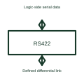

# RS-422 interface

An RS-422 interface uses differential signalling for its selected serial connection.

[Canonical reference](https://eloragrid.ai/symbols/rs-422-transceiver) · [Structured record](../entries/rs-422-transceiver.json) · [All references](README.md)

Updated: 2026-10-27. Drawing use: Schematic. Reference families: Manufacturer.

## What it represents

An RS-422 interface uses differential signalling for its selected serial connection.
A controller can communicate through a suitable differential driver and receiver arrangement.
Identify the driver and receiver ends of the intended differential connection. Do not copy an RS-485 multi-driver bus arrangement just because both names refer to differential interfaces. The chosen parts and network design establish the permitted connections and direction of information flow. This is original functional artwork, not a certified standard graphic or device pinout.

## How to read it

- Identify each driver and its receivers.
- Reference the selected termination and cable arrangement.
- Show logic connections and the receiving equipment’s electrical reference.
- An RS-422 label does not automatically imply an RS-485 multi-driver bus arrangement.

## Drawing checklist

- Identify each driver and its receivers.
- Reference the selected termination and cable arrangement.
- Show logic connections and the receiving equipment’s electrical reference.

## Important distinction

An RS-422 label does not automatically imply an RS-485 multi-driver bus arrangement.

## Facts

- Representation type: Original functional block; not a certified IEC or IEEE graphic
- Concept input: Logic-side serial data
- Concept output: Defined differential link

## Public references

- [RS-485 and RS-422 interfaces](https://www.ti.com/product-category/interface/rs-485-rs-422-transceivers/overview.html) — Texas Instruments. RS-485 and RS-422 interfaces: public technical context for the named function. Product and compliance details remain with the publisher.

## Related references

- [Logic bus transceiver](logic-bus-transceiver.md)
- [RS-485 transceiver](rs-485-transceiver.md)
- [Power converter / inverter](power-converter.md)
- [Terminal connection](terminal.md)

Original educational concept geometry, CC BY 4.0. Unitless; not a certified standards glyph or manufacturer footprint.

Elora-authored explanations are CC BY 4.0. Linked standards and manufacturer material retain their own rights. Confirm project requirements using primary sources.
