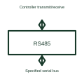

# RS-485 transceiver

An RS-485 transceiver sends and receives differential serial signals on its specified bus arrangement.

[Canonical reference](https://eloragrid.ai/symbols/rs-485-transceiver) · [Structured record](../entries/rs-485-transceiver.json) · [All references](README.md)

Updated: 2026-10-27. Drawing use: Schematic. Reference families: Manufacturer.

## What it represents

An RS-485 transceiver sends and receives differential serial signals on its specified bus arrangement.
An industrial device can use the interface to communicate over a compatible serial link.
Mark the logic-side transmit/receive signals and the bus pair separately. RS-485 describes the electrical interface, so a drawing should also identify the application protocol and the intended half- or full-duplex arrangement. Reference the selected termination, bias and protection circuits. This is original functional artwork, not a certified standard graphic or device pinout.

## How to read it

- Identify the application protocol separately from RS-485.
- Show the selected bus pair, termination and reference arrangement.
- Label direction-enable signals if the chosen transceiver uses them.
- RS-485 defines an electrical interface; it does not by itself specify the application protocol.

## Drawing checklist

- Identify the application protocol separately from RS-485.
- Show the selected bus pair, termination and reference arrangement.
- Label direction-enable signals if the chosen transceiver uses them.

## Important distinction

RS-485 defines an electrical interface; it does not by itself specify the application protocol.

## Facts

- Representation type: Original functional block; not a certified IEC or IEEE graphic
- Concept input: Controller transmit/receive
- Concept output: Specified serial bus

## Public references

- [RS-485 and RS-422 interfaces](https://www.ti.com/product-category/interface/rs-485-rs-422-transceivers/overview.html) — Texas Instruments. RS-485 and RS-422 interfaces: public technical context for the named function. Product and compliance details remain with the publisher.

## Related references

- [Logic bus transceiver](logic-bus-transceiver.md)
- [RS-422 interface](rs-422-transceiver.md)
- [Power converter / inverter](power-converter.md)
- [Terminal connection](terminal.md)

Original educational concept geometry, CC BY 4.0. Unitless; not a certified standards glyph or manufacturer footprint.

Elora-authored explanations are CC BY 4.0. Linked standards and manufacturer material retain their own rights. Confirm project requirements using primary sources.
