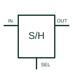

# Sample-and-hold amplifier

Acquires an analogue signal during the documented sampling interval and retains a representation during hold.

[Canonical reference](https://eloragrid.ai/symbols/sample-and-hold-amplifier) · [Structured record](../entries/sample-and-hold-amplifier.json) · [All references](README.md)

Updated: 2026-10-27. Drawing use: Schematic. Reference families: Manufacturer.

## What it represents

Acquires an analogue signal during the documented sampling interval and retains a representation during hold.
On a schematic, identify the analogue input, sample/hold control and storage or timing reference and trace the held analogue output and converter interface. Keep the component tag and signal/reference names consistent across the control drawing, terminal schedule and device documentation.
Hold behaviour is an analogue acquisition function; it differs from digital storage in a latch or flip-flop.
The preview is an independently drawn educational functional reference. Add the selected component’s actual power pins, terminal numbers, timing or analogue reference details when producing a construction drawing.

## How to read it

- Identify the analogue input, sample/hold control and storage or timing reference.
- Trace the held analogue output and converter interface.

## Drawing checklist

- Label the analogue input, sample/hold control and storage or timing reference.
- Cross-reference the held analogue output and converter interface.
- Add the selected device or circuit documentation revision, power/reference connections and project signal convention.

## Important distinction

Hold behaviour is an analogue acquisition function; it differs from digital storage in a latch or flip-flop.

## Facts

- Common schematic mnemonic: S/H — descriptive only; project/device documentation defines reference designations.
- Terminal / interface focus: The analogue input, sample/hold control and storage or timing reference
- Artwork scope: Original educational functional/circuit reference; not a selected product pinout.

## Public references

- [AN-1515: sample-and-hold function using an analogue switch](https://www.analog.com/en/resources/app-notes/an-1515.html) — Analog Devices. Public primary manufacturer documentation establishes the component function or circuit/topology relationship. Preview geometry and drafting explanations are independently authored.

## Related references

- [Positive-edge D flip-flop](positive-edge-d-flip-flop.md)
- [PLC input / output](plc-io.md)

Original educational concept geometry, CC BY 4.0. Unitless; not a certified standards glyph or manufacturer footprint.

Elora-authored explanations are CC BY 4.0. Linked standards and manufacturer material retain their own rights. Confirm project requirements using primary sources.
