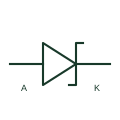

# Schottky diode

A metal-semiconductor diode used for rectification or clamping with device-specific forward and reverse characteristics.

[Canonical reference](https://eloragrid.ai/symbols/schottky-diode) · [Structured record](../entries/schottky-diode.json) · [All references](README.md)

Updated: 2026-10-27. Drawing use: Schematic. Reference families: Manufacturer.

## What it represents

A metal-semiconductor diode used for rectification or clamping with device-specific forward and reverse characteristics.
On a schematic, identify anode and cathode polarity and the selected reverse rating and trace the rectification or clamp current path. Keep the component tag and signal/reference names consistent across the control drawing, terminal schedule and device documentation.
A Schottky diode is a distinct junction technology; its forward drop is not a fixed universal value.
Terminal letters describe electrical roles, not package pin numbers. Check the selected public datasheet for the actual pin assignment, polarity and any internally connected terminals before completing the drawing.

## How to read it

- Identify anode and cathode polarity and the selected reverse rating.
- Trace the rectification or clamp current path.

## Drawing checklist

- Label anode and cathode polarity and the selected reverse rating.
- Cross-reference the rectification or clamp current path.
- Add the selected device or circuit documentation revision, power/reference connections and project signal convention.

## Important distinction

A Schottky diode is a distinct junction technology; its forward drop is not a fixed universal value.

## Facts

- Common schematic mnemonic: SBD — descriptive only; project/device documentation defines reference designations.
- Terminal / interface focus: Anode and cathode polarity and the selected reverse rating
- Artwork scope: Original educational component glyph; not a certified standard graphic or package pinout.

## Public references

- [Diode families and public diode documentation](https://www.nexperia.com/products/diodes) — Nexperia. Public primary manufacturer documentation establishes the component function or circuit/topology relationship. Preview geometry and drafting explanations are independently authored.

## Related references

- [Diode](diode.md)
- [Power converter / inverter](power-converter.md)

Original educational concept geometry, CC BY 4.0. Unitless; not a certified standards glyph or manufacturer footprint.

Elora-authored explanations are CC BY 4.0. Linked standards and manufacturer material retain their own rights. Confirm project requirements using primary sources.
