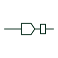

# Separable cable connector

A plug-in screened termination that connects a medium voltage cable to an equipment bushing and can be separated.

[Canonical reference](https://eloragrid.ai/symbols/separable-cable-connector) · [Structured record](../entries/separable-cable-connector.json) · [All references](README.md)

Updated: 2026-10-28. Drawing use: SLD, Schematic. Reference families: IEC, IEEE / ANSI.

## What it represents

Separable connectors, such as elbow and T-body connectors, terminate a medium voltage cable onto a bushing so that the cable can be disconnected without cutting it. They appear on ring main units, pad-mounted transformers and switchgear with standardised bushing interfaces, and the T-body form often allows a second cable or a surge arrester to be stacked behind it.
The drawing symbol identifies the plug-in interface but not the interface type, current rating or whether the connector is load-break or dead-break. Those details determine whether it may be operated under load and must be given in text. A dead-break connector must never be separated while energised.

## How to read it

- Check whether the connector is load-break or dead-break.
- Look for stacked arresters or second cables on T-bodies.

## Drawing checklist

- State interface type and rating.
- Identify load-break or dead-break.
- Show any arrester or cable stacked on the connector.

## Important distinction

A separable connector plugs onto a bushing and can be removed; a sealing end is a fixed termination.

## Facts

- Graphic cue: Cable ending in a plug half engaging a bushing
- Operating limit: Dead-break versions must not be separated while energised
- Preview: Original educational illustration; consult the publisher and applicable standard for the exact graphic

## Public references

- [Elastimold underground cable accessories](https://www.abb.com/global/en/areas/electrification/medium-voltage/cable-accessories-connectors/underground/elastimold/underground) — ABB. Manufacturer context for separable cable connectors and accessories.
- [IEEE/ANSI 315-1975: graphic symbols for electrical and electronics diagrams](https://standards.ieee.org/ieee/315/515/) — IEEE Standards Association. Standards context for connector graphics.

## Related references

- [Single-core cable sealing end](iec-single-core-cable-sealing-end.md)
- [Connector plug half](connector-plug-half.md)
- [Surge arrester](surge-arrester.md)

Original educational concept geometry, CC BY 4.0. Unitless; not a certified standards glyph or manufacturer footprint.

Elora-authored explanations are CC BY 4.0. Linked standards and manufacturer material retain their own rights. Confirm project requirements using primary sources.
