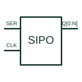

# Serial-in parallel-out register

Shifts serial input data through storage stages to parallel outputs at the documented clock events.

[Canonical reference](https://eloragrid.ai/symbols/serial-in-parallel-out-register) · [Structured record](../entries/serial-in-parallel-out-register.json) · [All references](README.md)

Updated: 2026-10-27. Drawing use: Schematic. Reference families: Manufacturer.

## What it represents

Shifts serial input data through storage stages to parallel outputs at the documented clock events.
On a schematic, identify the serial input, shift clock and clear control and trace the parallel output bits and their bit-order mapping. Keep the component tag and signal/reference names consistent across the control drawing, terminal schedule and device documentation.
A SIPO register exposes its shifted bits; an output-latched register can retain a separate displayed output word.
The preview is an independently drawn educational functional reference. Add the selected component’s actual power pins, terminal numbers, timing or analogue reference details when producing a construction drawing.

## How to read it

- Identify the serial input, shift clock and clear control.
- Trace the parallel output bits and their bit-order mapping.

## Drawing checklist

- Label the serial input, shift clock and clear control.
- Cross-reference the parallel output bits and their bit-order mapping.
- Add the selected device or circuit documentation revision, power/reference connections and project signal convention.

## Important distinction

A SIPO register exposes its shifted bits; an output-latched register can retain a separate displayed output word.

## Facts

- Common schematic mnemonic: SIPO — descriptive only; project/device documentation defines reference designations.
- Terminal / interface focus: The serial input, shift clock and clear control
- Artwork scope: Original educational functional/circuit reference; not a selected product pinout.

## Public references

- [SN74HC164 — serial-in parallel-out shift storage](https://www.ti.com/lit/ds/symlink/sn74hc164.pdf) — Texas Instruments. Public primary manufacturer documentation establishes the component function or circuit/topology relationship. Preview geometry and drafting explanations are independently authored.

## Related references

- [Shift register with output latch](latched-shift-register.md)
- [PLC input / output](plc-io.md)

Original educational concept geometry, CC BY 4.0. Unitless; not a certified standards glyph or manufacturer footprint.

Elora-authored explanations are CC BY 4.0. Linked standards and manufacturer material retain their own rights. Confirm project requirements using primary sources.
