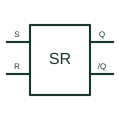

# Set-reset latch

Retains a digital state that is changed by the defined set or reset input conditions.

[Canonical reference](https://eloragrid.ai/symbols/set-reset-latch) · [Structured record](../entries/set-reset-latch.json) · [All references](README.md)

Updated: 2026-10-27. Drawing use: Schematic. Reference families: Manufacturer.

## What it represents

Retains a digital state that is changed by the defined set or reset input conditions.
On a schematic, identify the set/reset active levels and any prohibited simultaneous condition and trace the stored output and reset/startup logic. Keep the component tag and signal/reference names consistent across the control drawing, terminal schedule and device documentation.
Active-high and active-low SR implementations have different input conventions; a bare SR label does not resolve simultaneous-input behaviour.
The preview is an independently drawn educational functional reference. Add the selected component’s actual power pins, terminal numbers, timing or analogue reference details when producing a construction drawing.

## How to read it

- Identify the set/reset active levels and any prohibited simultaneous condition.
- Trace the stored output and reset/startup logic.

## Drawing checklist

- Label the set/reset active levels and any prohibited simultaneous condition.
- Cross-reference the stored output and reset/startup logic.
- Add the selected device or circuit documentation revision, power/reference connections and project signal convention.

## Important distinction

Active-high and active-low SR implementations have different input conventions; a bare SR label does not resolve simultaneous-input behaviour.

## Facts

- Common schematic mnemonic: SR-LATCH — descriptive only; project/device documentation defines reference designations.
- Terminal / interface focus: The set/reset active levels and any prohibited simultaneous condition
- Artwork scope: Original educational functional/circuit reference; not a selected product pinout.

## Public references

- [SN74LS279A — set-reset latches](https://www.ti.com/product/SN74LS279A) — Texas Instruments. Public primary manufacturer documentation establishes the component function or circuit/topology relationship. Preview geometry and drafting explanations are independently authored.

## Related references

- [Transparent D latch](transparent-d-latch.md)
- [PLC input / output](plc-io.md)

Original educational concept geometry, CC BY 4.0. Unitless; not a certified standards glyph or manufacturer footprint.

Elora-authored explanations are CC BY 4.0. Linked standards and manufacturer material retain their own rights. Confirm project requirements using primary sources.
