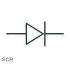

# Silicon-controlled rectifier

An SCR is a thyristor with a gate-controlled triggering function in its documented circuit.

[Canonical reference](https://eloragrid.ai/symbols/silicon-controlled-rectifier) · [Structured record](../entries/silicon-controlled-rectifier.json) · [All references](README.md)

Updated: 2026-10-27. Drawing use: Schematic. Reference families: IEC, Manufacturer.

## What it represents

An SCR is a thyristor with a gate-controlled triggering function in its documented circuit. Anode, cathode and gate connections must be distinguished to understand the control path.

## How to read it

- Read turn-on and current-interruption behaviour from the chosen circuit and component.
- The preview is an original explanation of this function. Match the actual drawing convention to its legend and the selected equipment documentation.

## Drawing checklist

- Label gate/anode/cathode
- Reference gate drive
- State voltage/current ratings

## Important distinction

An SCR is not the same as a bidirectional TRIAC.

## Facts

- Drawing role: Semiconductor function
- Representation scope: Functional concept; not an official standard graphic or a product footprint
- Public vendor block reference: HDI1V4, VDI1V4 (Autodesk identifiers; not IEC symbol numbers)
- Identifier status: The short label is a functional lookup label, not an assigned IEC or IEEE symbol number. Any separately listed Autodesk code is a verified vendor block name.

## Public references

- [AutoCAD Electrical: Semiconductor components](https://help.autodesk.com/cloudhelp/2021/ENU/AutoCAD-Electrical/files/GUID-AC954072-7314-4682-88AF-38160D61E9A2.htm) — Autodesk. Public documentation of this equipment function or named vendor variant; the illustration is independently authored and is not the source graphic.

## Related references

- [Resistor](resistor.md)
- [Power converter / inverter](power-converter.md)

Original educational concept geometry, CC BY 4.0. Unitless; not a certified standards glyph or manufacturer footprint.

Elora-authored explanations are CC BY 4.0. Linked standards and manufacturer material retain their own rights. Confirm project requirements using primary sources.
