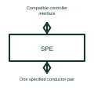

# Single-pair Ethernet interface

A single-pair Ethernet interface uses its specified physical-layer arrangement over one conductor pair.

[Canonical reference](https://eloragrid.ai/symbols/single-pair-ethernet-interface) · [Structured record](../entries/single-pair-ethernet-interface.json) · [All references](README.md)

Updated: 2026-10-27. Drawing use: Schematic. Reference families: Manufacturer.

## What it represents

A single-pair Ethernet interface uses its specified physical-layer arrangement over one conductor pair.
A compatible industrial node can use the selected PHY and connector for its single-pair link.
Label the specific single-pair Ethernet variant and identify both cable ends. One pair describes the conductor arrangement, not a universal speed, distance or connector. Show any power-over-data arrangement separately and only where the selected equipment supports it. This is original functional artwork, not a certified standard graphic or device pinout.

## How to read it

- State the selected single-pair physical-layer variant.
- Reference the supported connector and cable design.
- Identify any power-delivery function separately.
- The single-pair label does not make every Ethernet variant or connector interchangeable.

## Drawing checklist

- State the selected single-pair physical-layer variant.
- Reference the supported connector and cable design.
- Identify any power-delivery function separately.

## Important distinction

The single-pair label does not make every Ethernet variant or connector interchangeable.

## Facts

- Representation type: Original functional block; not a certified IEC or IEEE graphic
- Concept input: Compatible controller interface
- Concept output: One specified conductor pair

## Public references

- [Ethernet physical interfaces](https://www.ti.com/product-category/interface/ethernet-ics/overview.html) — Texas Instruments. Ethernet physical interfaces: public technical context for the named function. Product and compliance details remain with the publisher.

## Related references

- [Industrial Ethernet switch](ga-industrial-ethernet-switch.md)
- [Ethernet physical-layer transceiver](ethernet-phy.md)
- [Power converter / inverter](power-converter.md)
- [Terminal connection](terminal.md)

Original educational concept geometry, CC BY 4.0. Unitless; not a certified standards glyph or manufacturer footprint.

Elora-authored explanations are CC BY 4.0. Linked standards and manufacturer material retain their own rights. Confirm project requirements using primary sources.
