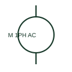

# Single-phase AC motor

A single-phase AC motor represents a load supplied from a documented single-phase source.

[Canonical reference](https://eloragrid.ai/symbols/single-phase-ac-motor) · [Structured record](../entries/single-phase-ac-motor.json) · [All references](README.md)

Updated: 2026-10-27. Drawing use: SLD, Schematic. Reference families: IEC, Manufacturer.

## What it represents

A single-phase AC motor represents a load supplied from a documented single-phase source. Its actual winding, starting component and terminal arrangement require the selected motor connection diagram.

## How to read it

- A simplified motor image does not show every start or run winding.
- The preview is an original explanation of this function. Match the actual drawing convention to its legend and the selected equipment documentation.

## Drawing checklist

- State supply voltage
- Reference motor terminal diagram
- Show starting/protection arrangement

## Important distinction

Single-phase supply and the motor's starting method are different drawing attributes.

## Facts

- Drawing role: Rotating or linear load
- Representation scope: Functional concept; not an official standard graphic or a product footprint
- Public vendor block reference: HMO1M9, VMO1M9 (Autodesk identifiers; not IEC symbol numbers)
- Identifier status: The short label is a functional lookup label, not an assigned IEC or IEEE symbol number. Any separately listed Autodesk code is a verified vendor block name.

## Public references

- [AutoCAD Electrical: Single-phase motors](https://help.autodesk.com/cloudhelp/2021/ENU/AutoCAD-Electrical/files/GUID-F82048DA-0D71-4720-B9F7-3E64B7500E76.htm) — Autodesk. Public documentation of this equipment function or named vendor variant; the illustration is independently authored and is not the source graphic.

## Related references

- [Three-phase motor](motor.md)
- [Contactor](contactor.md)

Original educational concept geometry, CC BY 4.0. Unitless; not a certified standards glyph or manufacturer footprint.

Elora-authored explanations are CC BY 4.0. Linked standards and manufacturer material retain their own rights. Confirm project requirements using primary sources.
