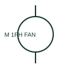

# Single-phase motor with fan

A single-phase motor with an associated fan identifies the driven function as well as the electrical load.

[Canonical reference](https://eloragrid.ai/symbols/single-phase-motor-with-fan) · [Structured record](../entries/single-phase-motor-with-fan.json) · [All references](README.md)

Updated: 2026-10-27. Drawing use: SLD, Schematic. Reference families: IEC, Manufacturer.

## What it represents

A single-phase motor with an associated fan identifies the driven function as well as the electrical load. Its schematic supply is separate from the airflow or installation detail.

## How to read it

- Link the motor tag to the cabinet or auxiliary fan shown on the layout.
- The preview is an original explanation of this function. Match the actual drawing convention to its legend and the selected equipment documentation.

## Drawing checklist

- Name fan/motor tag
- State electrical rating
- Reference airflow and installation data

## Important distinction

A fan annotation identifies driven equipment, not a new electrical phase system.

## Facts

- Drawing role: Rotating or linear load
- Representation scope: Functional concept; not an official standard graphic or a product footprint
- Public vendor block reference: HMO1M3M, VMO1M3M (Autodesk identifiers; not IEC symbol numbers)
- Identifier status: The short label is a functional lookup label, not an assigned IEC or IEEE symbol number. Any separately listed Autodesk code is a verified vendor block name.

## Public references

- [AutoCAD Electrical: Single-phase motors](https://help.autodesk.com/cloudhelp/2021/ENU/AutoCAD-Electrical/files/GUID-F82048DA-0D71-4720-B9F7-3E64B7500E76.htm) — Autodesk. Public documentation of this equipment function or named vendor variant; the illustration is independently authored and is not the source graphic.

## Related references

- [Three-phase motor](motor.md)
- [Contactor](contactor.md)

Original educational concept geometry, CC BY 4.0. Unitless; not a certified standards glyph or manufacturer footprint.

Elora-authored explanations are CC BY 4.0. Linked standards and manufacturer material retain their own rights. Confirm project requirements using primary sources.
