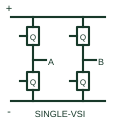

# Single-phase voltage-source inverter

A switching bridge that forms a documented single-phase AC output from a DC-link source.

[Canonical reference](https://eloragrid.ai/symbols/single-phase-voltage-source-inverter) · [Structured record](../entries/single-phase-voltage-source-inverter.json) · [All references](README.md)

Updated: 2026-10-27. Drawing use: Schematic, SLD. Reference families: Manufacturer.

## What it represents

A switching bridge that forms a documented single-phase AC output from a DC-link source.
On a schematic, identify the DC-link rails, bridge-leg midpoints and AC output/filter reference and trace the AC load or connection point and switching control. Keep the component tag and signal/reference names consistent across the control drawing, terminal schedule and device documentation.
The bridge can produce a switched waveform; output quality and connection requirements depend on the filter and control design.
The preview is a conceptual topology reference rather than a complete power-stage circuit. Switching sequences, magnetic design, component selection and control/protection details belong in the equipment design documentation.

## How to read it

- Identify the DC-link rails, bridge-leg midpoints and AC output/filter reference.
- Trace the AC load or connection point and switching control.

## Drawing checklist

- Label the DC-link rails, bridge-leg midpoints and AC output/filter reference.
- Cross-reference the AC load or connection point and switching control.
- Add the selected device or circuit documentation revision, power/reference connections and project signal convention.

## Important distinction

The bridge can produce a switched waveform; output quality and connection requirements depend on the filter and control design.

## Facts

- Common schematic mnemonic: 1PH-VSI — descriptive only; project/device documentation defines reference designations.
- Terminal / interface focus: The DC-link rails, bridge-leg midpoints and AC output/filter reference
- Artwork scope: Original conceptual topology block; not a complete switch-level circuit.

## Public references

- [Bidirectional three-/single-phase AC/DC PFC and inverter application note](https://www.infineon.com/assets/row/public/documents/24/42/infineon-ac-dc-pfc-11-kw-high-efficiency-high-density-bidirectional-three-single-phase-inverter-applicationnotes-en.pdf) — Infineon Technologies. Public primary manufacturer documentation establishes the component function or circuit/topology relationship. Preview geometry and drafting explanations are independently authored.

## Related references

- [DC-to-AC inverter](dc-to-ac-inverter.md)
- [Power converter / inverter](power-converter.md)

Original educational concept geometry, CC BY 4.0. Unitless; not a certified standards glyph or manufacturer footprint.

Elora-authored explanations are CC BY 4.0. Linked standards and manufacturer material retain their own rights. Confirm project requirements using primary sources.
