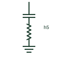

# Single-tuned harmonic filter

A shunt series-LC branch tuned near one harmonic order to sink that harmonic current from the network.

[Canonical reference](https://eloragrid.ai/symbols/single-tuned-harmonic-filter) · [Structured record](../entries/single-tuned-harmonic-filter.json) · [All references](README.md)

Updated: 2026-10-28. Drawing use: SLD, Schematic. Reference families: IEC, IEEE / ANSI.

## What it represents

A single-tuned filter is a capacitor and reactor in series, connected in shunt and tuned to resonate near one harmonic frequency, often slightly below the 5th, 7th or 11th. At that frequency it presents a low impedance and draws harmonic current away from the network, while at fundamental frequency it supplies capacitive reactive power.
Drawings show a capacitor and reactor in series on a shunt branch, labelled with the tuned order, and often several such branches for different orders. Unbalance protection for the capacitor bank and a dedicated breaker are normally shown.
A tuned filter creates a parallel resonance with the network at a frequency just below its tuning, which can amplify other harmonics. The symbol does not show the network impedance scan or detuning tolerance, so the harmonic study must accompany it.

## How to read it

- Read the harmonic order label on each branch.
- The filter also supplies fundamental reactive power.

## Drawing checklist

- State tuned order, Mvar and quality factor.
- Show breaker and unbalance protection.
- Reference harmonic study.

## Important distinction

A single-tuned filter targets one harmonic order; a damped high-pass filter attenuates a broad band above its corner frequency.

## Facts

- Elements: Series capacitor and reactor
- Behaviour at tuning: Low impedance sink
- Fundamental output: Capacitive Mvar
- Preview: Independent educational illustration; consult the applicable standard and project legend for the exact graphic

## Public references

- [Capacitor and filter product offerings](https://www.hitachienergy.com/products-and-solutions/capacitors-and-filters) — Hitachi Energy. Public passive and harmonic filter product context.
- [AutoCAD Electrical: Reactors and inductors](https://help.autodesk.com/cloudhelp/2021/ENU/AutoCAD-Electrical/files/GUID-BAD50DBF-0951-44A0-BB4C-A57B4A4ED895.htm) — Autodesk. Public reactor symbol family context.

## Related references

- [Damped high-pass harmonic filter](damped-high-pass-harmonic-filter.md)
- [Detuned capacitor bank](detuned-capacitor-bank.md)
- [Active harmonic filter](active-harmonic-filter.md)
- [Static var compensator](static-var-compensator.md)

Original educational concept geometry, CC BY 4.0. Unitless; not a certified standards glyph or manufacturer footprint.

Elora-authored explanations are CC BY 4.0. Linked standards and manufacturer material retain their own rights. Confirm project requirements using primary sources.
