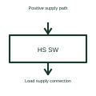

# Smart high-side switch

A high-side switch controls the connection between a supply and the high side of a load.

[Canonical reference](https://eloragrid.ai/symbols/smart-high-side-switch) · [Structured record](../entries/smart-high-side-switch.json) · [All references](README.md)

Updated: 2026-10-27. Drawing use: Schematic. Reference families: Manufacturer.

## What it represents

A high-side switch controls the connection between a supply and the high side of a load.
A controller can switch the positive supply path to an attached device using the selected component.
Draw the switch between the positive supply and the load, with the return path shown separately. Identify any diagnostic output as a signal rather than another power connection. The word smart does not define a universal set of protection or diagnostic features. This is original functional artwork, not a certified standard graphic or device pinout.

## How to read it

- Locate the switch on the supply side of the load.
- Label control and diagnostic signals separately.
- Reference the selected load, fault and thermal behaviour.
- Monitoring and protection features depend on the chosen device, not merely the high-side position.

## Drawing checklist

- Locate the switch on the supply side of the load.
- Label control and diagnostic signals separately.
- Reference the selected load, fault and thermal behaviour.

## Important distinction

Monitoring and protection features depend on the chosen device, not merely the high-side position.

## Facts

- Representation type: Original functional block; not a certified IEC or IEEE graphic
- Concept input: Positive supply path
- Concept output: Load supply connection

## Public references

- [High-side power switching](https://www.ti.com/product-category/power-management/high-side-switches-controllers/overview.html) — Texas Instruments. High-side power switching: public technical context for the named function. Product and compliance details remain with the publisher.

## Related references

- [High-side gate driver](high-side-gate-driver.md)
- [Power converter / inverter](power-converter.md)
- [Terminal connection](terminal.md)

Original educational concept geometry, CC BY 4.0. Unitless; not a certified standards glyph or manufacturer footprint.

Elora-authored explanations are CC BY 4.0. Linked standards and manufacturer material retain their own rights. Confirm project requirements using primary sources.
