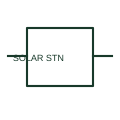

# Solar generating station

A solar generating station is a system-level representation of a documented solar-generation facility.

[Canonical reference](https://eloragrid.ai/symbols/solar-generating-station) · [Structured record](../entries/solar-generating-station.json) · [All references](README.md)

Updated: 2026-10-27. Drawing use: SLD, Schematic. Reference families: IEC, Manufacturer.

## What it represents

A solar generating station is a system-level representation of a documented solar-generation facility. It identifies the facility type on a system diagram rather than replacing its internal electrical design.

## How to read it

- Use linked SLDs to identify the array, inverter and connection equipment within the station.
- The preview is an original explanation of this function. Match the actual drawing convention to its legend and the selected equipment documentation.

## Drawing checklist

- Name facility boundary
- Reference internal SLD
- Identify connection point

## Important distinction

A station-type marker is a site-level concept, not a single PV module symbol.

## Facts

- Drawing role: Supply or network role
- Representation scope: Functional concept; not an official standard graphic or a product footprint
- Public vendor block reference: HDV1\_S00400, VDV1\_S00400 (Autodesk identifiers; not IEC symbol numbers)
- Identifier status: The short label is a functional lookup label, not an assigned IEC or IEEE symbol number. Any separately listed Autodesk code is a verified vendor block name.

## Public references

- [AutoCAD Electrical: Power station and substation concepts](https://help.autodesk.com/cloudhelp/2021/ENU/AutoCAD-Electrical/files/GUID-74EF80E8-018D-4A57-88BD-FF973F1B8185.htm) — Autodesk. Public documentation of this equipment function or named vendor variant; the illustration is independently authored and is not the source graphic.

## Related references

- [Generator](generator.md)
- [Busbar](busbar.md)

Original educational concept geometry, CC BY 4.0. Unitless; not a certified standards glyph or manufacturer footprint.

Elora-authored explanations are CC BY 4.0. Linked standards and manufacturer material retain their own rights. Confirm project requirements using primary sources.
