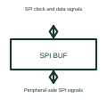

# SPI interface buffer

An SPI buffer supports the selected digital signal paths between an SPI controller and its peripheral interface.

[Canonical reference](https://eloragrid.ai/symbols/spi-interface-buffer) · [Structured record](../entries/spi-interface-buffer.json) · [All references](README.md)

Updated: 2026-10-27. Drawing use: Schematic. Reference families: Manufacturer.

## What it represents

An SPI buffer supports the selected digital signal paths between an SPI controller and its peripheral interface.
A design can buffer clock and data lines where its electrical and timing requirements call for it.
Identify the clock, controller-to-peripheral data, peripheral-to-controller data and chip-select paths separately. Unlike a generic two-wire bus, these signals can have different directions. A buffer or translator must preserve their timing and the chosen device’s operating levels. This is original functional artwork, not a certified standard graphic or device pinout.

## How to read it

- Label clock, data directions and each chip select.
- Reference the supported logic supplies and timing.
- Show enable or direction-control inputs where used.
- The SPI block must identify signal direction, chip select and timing; it is not an arbitrary interchangeable serial port.

## Drawing checklist

- Label clock, data directions and each chip select.
- Reference the supported logic supplies and timing.
- Show enable or direction-control inputs where used.

## Important distinction

The SPI block must identify signal direction, chip select and timing; it is not an arbitrary interchangeable serial port.

## Facts

- Representation type: Original functional block; not a certified IEC or IEEE graphic
- Concept input: SPI clock and data signals
- Concept output: Peripheral-side SPI signals

## Public references

- [Direction-controlled translation for SPI interfaces](https://www.ti.com/product/SN74AXC4T774) — Texas Instruments. Primary-source technical context for this particular function; product-specific ratings remain with the manufacturer.

## Related references

- [Logic voltage-level translator](logic-voltage-level-translator.md)
- [I2C bus buffer](i2c-bus-buffer.md)
- [I2C voltage-level translator](i2c-level-translator.md)
- [Power converter / inverter](power-converter.md)

Original educational concept geometry, CC BY 4.0. Unitless; not a certified standards glyph or manufacturer footprint.

Elora-authored explanations are CC BY 4.0. Linked standards and manufacturer material retain their own rights. Confirm project requirements using primary sources.
