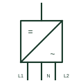

# Split-phase inverter

An inverter with two 180-degree displaced outputs and a neutral, supplying 120/240 V split-phase installations.

[Canonical reference](https://eloragrid.ai/symbols/split-phase-inverter) · [Structured record](../entries/split-phase-inverter.json) · [All references](README.md)

Updated: 2026-10-28. Drawing use: SLD, Schematic. Reference families: IEC, IEEE / ANSI, Manufacturer.

## What it represents

A split-phase inverter produces two AC outputs 180 degrees apart with a shared neutral, giving 120 V from each line to neutral and 240 V between lines. This matches North American residential and small commercial supplies, so the inverter can feed a standard load centre in off-grid or backup systems.
Drawings show the inverter block with three AC output conductors, L1, L2 and N, often with an internal or external autotransformer that balances unequal loads on the two halves. Neutral-earth bonding relays and the generator or grid input are drawn as for other inverter-chargers.
Unequal loading on L1 and L2 must be handled by the inverter or an autotransformer; otherwise one half can overload while the total rating appears adequate. The symbol does not show the per-leg current rating or the bonding arrangement.

## How to read it

- Read the per-leg rating as well as the total rating.
- Check for an autotransformer used for load balancing.

## Drawing checklist

- State total and per-leg ratings.
- Show L1, L2, N and bonding.
- Reference load balance between legs.

## Important distinction

A split-phase inverter produces two antiphase legs; a three-phase inverter produces three legs 120 degrees apart.

## Facts

- Outputs: L1, L2 at 180 degrees, neutral
- Voltages: 120 V line to neutral, 240 V line to line
- Balancing: Internal or external autotransformer
- Preview: Independent educational illustration; consult the applicable standard and project legend for the exact graphic

## Public references

- [MultiPlus-II 2x 120V official product and documents](https://www.victronenergy.com/inverters-chargers/multiplus-ii-2x-120v) — Victron Energy. Public split-phase inverter-charger documentation.
- [Inverters product listing](https://www.victronenergy.com/inverters) — Victron Energy. Public inverter product listing.

## Related references

- [Bidirectional inverter-charger](bidirectional-inverter-charger.md)
- [DC-to-AC inverter](dc-to-ac-inverter.md)
- [Single-phase autotransformer](single-phase-autotransformer.md)

Original educational concept geometry, CC BY 4.0. Unitless; not a certified standards glyph or manufacturer footprint.

Elora-authored explanations are CC BY 4.0. Linked standards and manufacturer material retain their own rights. Confirm project requirements using primary sources.
