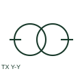

# Star-star transformer

A star-star transformer has star-connected windings on both sides.

[Canonical reference](https://eloragrid.ai/symbols/star-star-transformer) · [Structured record](../entries/star-star-transformer.json) · [All references](README.md)

Updated: 2026-10-27. Drawing use: SLD, Schematic. Reference families: IEC, Manufacturer.

## What it represents

A star-star transformer has star-connected windings on both sides. Neutral accessibility and system earthing must be shown independently for each winding.

## How to read it

- Check whether one, both or neither star point is brought to terminals.
- The preview is an original explanation of this function. Match the actual drawing convention to its legend and the selected equipment documentation.

## Drawing checklist

- Identify neutral terminals
- State vector group
- Show earthing connections

## Important distinction

The Y-Y label does not by itself establish neutral availability.

## Facts

- Drawing role: Winding connection
- Representation scope: Functional concept; not an official standard graphic or a product footprint
- Public vendor block reference: HXF1T7, VXF1T7 (Autodesk identifiers; not IEC symbol numbers)
- Identifier status: The short label is a functional lookup label, not an assigned IEC or IEEE symbol number. Any separately listed Autodesk code is a verified vendor block name.

## Public references

- [Power, potential and autotransformer symbols](https://help.autodesk.com/cloudhelp/2021/ENU/AutoCAD-Electrical/files/GUID-C1FE1690-DBF4-4F69-85C4-28E41F0A6392.htm) — Autodesk. Public documentation of this equipment function or named vendor variant; the illustration is independently authored and is not the source graphic.
- [AutoCAD Electrical: Three-phase transformer connections](https://help.autodesk.com/cloudhelp/2021/ENU/AutoCAD-Electrical/files/GUID-EB13DB13-01EE-4541-BED7-19B9001BE8FC.htm) — Autodesk. Public documentation of this equipment function or named vendor variant; the illustration is independently authored and is not the source graphic.

## Related references

- [Power transformer](power-transformer.md)
- [Voltage transformer](voltage-transformer.md)

Original educational concept geometry, CC BY 4.0. Unitless; not a certified standards glyph or manufacturer footprint.

Elora-authored explanations are CC BY 4.0. Linked standards and manufacturer material retain their own rights. Confirm project requirements using primary sources.
