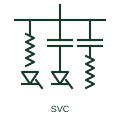

# Static var compensator

A shunt reactive power compensator built from thyristor-controlled reactors, thyristor-switched capacitors and filters.

[Canonical reference](https://eloragrid.ai/symbols/static-var-compensator) · [Structured record](../entries/static-var-compensator.json) · [All references](README.md)

Updated: 2026-10-28. Drawing use: SLD. Reference families: IEC, IEEE / ANSI.

## What it represents

A static var compensator is a shunt-connected installation that controls voltage by rapidly varying the reactive power it exchanges with the network. Its branches are typically a thyristor-controlled reactor, one or more thyristor-switched capacitors and harmonic filters, all connected to the secondary of a dedicated step-down transformer.
Single-line diagrams show the compensator transformer feeding a medium-voltage bus with each branch drawn separately, or a summary block labelled SVC with a variable capacitor-reactor symbol. It is used at transmission substations, at large industrial loads such as arc furnaces and at some renewable connection points.
Because its output is based on switched reactances, available reactive current falls with voltage, so it gives less support during deep voltage dips than a STATCOM. The symbol does not show the control slope, the branch ratings or the harmonic performance.

## How to read it

- Read each branch rating to find the inductive and capacitive range.
- Filters in an SVC usually also supply part of the capacitive output.

## Drawing checklist

- State capacitive and inductive range in Mvar.
- Show transformer and branches.
- Reference voltage control slope.

## Important distinction

An SVC varies switched reactances; a STATCOM uses a voltage-source converter and holds output current better at low voltage.

## Facts

- Branches: TCR, TSC and harmonic filters
- Connection: Shunt, usually through a transformer
- Low-voltage behaviour: Output falls with voltage squared
- Preview: Independent educational illustration; consult the applicable standard and project legend for the exact graphic

## Public references

- [Static Var Compensators (SVC)](https://www.hitachienergy.com/products-and-solutions/facts/static-var-compensation-svc) — Hitachi Energy. Public SVC page describing TCR, TSC and harmonic filter branches.
- [IEC graphical symbols for diagrams](https://tc3.iec.ch/tc-activity/graphical-symbols-for-diagrams/) — IEC. IEC graphical symbol context for reactors and capacitors.

## Related references

- [Thyristor-controlled reactor](thyristor-controlled-reactor.md)
- [Thyristor-switched capacitor](thyristor-switched-capacitor.md)
- [Static synchronous compensator](statcom.md)
- [Single-tuned harmonic filter](single-tuned-harmonic-filter.md)

Original educational concept geometry, CC BY 4.0. Unitless; not a certified standards glyph or manufacturer footprint.

Elora-authored explanations are CC BY 4.0. Linked standards and manufacturer material retain their own rights. Confirm project requirements using primary sources.
