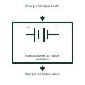

# Station charger AC-failure indication

Reports loss of the assigned charger input supply while distinguishing the available battery path.

[Canonical reference](https://eloragrid.ai/symbols/station-charger-ac-failure-indication) · [Structured record](../entries/station-charger-ac-failure-indication.json) · [All references](README.md)

Updated: 2026-11-03. Drawing use: Schematic. Reference families: Manufacturer.

Representation: functional-block; installation focus: substations.
Charger AC input health
Charger AC-failure alarm

## What it represents

Reports loss of the assigned charger input supply while distinguishing the available battery path. A station battery system supplies protection, control and other assigned DC loads through a documented charger and distribution arrangement. Charger output, battery contribution and load distribution are related but separately monitored paths.
In a substation control building, the battery can support breaker trip circuits while the charger AC supply is unavailable. Supervision must identify whether the charger, battery or a downstream feeder is affected. For this reference, the drawing identifies “Charger AC input health” at the input and “Charger AC-failure alarm” at the output. Battery support may remain available.
Identify every source, protective device, isolation boundary and return. Battery capacity, DC fault duty, charging settings and ventilation require the selected battery-system design; illustrative circuits do not establish autonomy. The functional block is an independent explanation of this named application. Equipment-specific ratings, terminal connections and operating conditions must be established in the project documentation.

## How to read it

- Start at the named input: Charger AC input health. Identify its source device or document and the state represented on the drawing.
- Follow the named output: Charger AC-failure alarm. Cross-reference its destination and separate the command from confirmation that the equipment responded.
- Battery support may remain available.
- Identify every source, protective device, isolation boundary and return. Battery capacity, DC fault duty, charging settings and ventilation require the selected battery-system design; illustrative circuits do not establish autonomy.

## Drawing checklist

- Label the source and connection reference for charger ac input health.
- Identify the destination and defined state of charger ac-failure alarm.
- Record the equipment or control-document revision supporting this functional block.
- Check this application limit in the project design: Battery support may remain available.

## Important distinction

Battery support may remain available. This reference describes the named application; it does not establish a new IEC graphical symbol, an ANSI device-function number or an exact manufacturer connection diagram.

## Facts

- Representation: Functional block
- Installation focus: Substations
- Input / boundary: Charger AC input health
- Output / connection: Charger AC-failure alarm
- Lookup label: SCAI is a library lookup label, not a standard device designation.

## Public references

- [MicroGenius S2/S4 battery charger technical manual](https://www.sens-usa.com/hubfs/Controlled%20Files/Manuals/101330_MGS_User_Manual.pdf) — SENS. Public technical context for station battery and charger distribution. Battery charging modes, DC distribution interfaces and charger alarms. The application text and educational graphic are independently authored; the publisher does not certify this representation.

## Related references

- [Station DC battery rack](ga-station-dc-battery-rack.md)
- [Battery charger](ga-battery-charger.md)
- [Station charger DC-output failure indication](station-charger-dc-output-failure-indication.md)

Original educational concept geometry, CC BY 4.0. Unitless; not a certified standards glyph or manufacturer footprint.

Elora-authored explanations are CC BY 4.0. Linked standards and manufacturer material retain their own rights. Confirm project requirements using primary sources.
