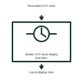

# Station UTC-local display boundary

Separates the common recorded time basis from an operator's displayed local time.

[Canonical reference](https://eloragrid.ai/symbols/station-utc-local-display-boundary) · [Structured record](../entries/station-utc-local-display-boundary.json) · [All references](README.md)

Updated: 2026-11-03. Drawing use: Schematic. Reference families: Manufacturer.

Representation: functional-block; installation focus: substations.
Recorded UTC time
Local display time

## What it represents

Separates the common recorded time basis from an operator's displayed local time. A station time system provides a shared time reference for protection records, measurements and automation. Different devices can use different timing protocols, so the time source, distribution path and quality information must remain identifiable.
In a substation, a station clock can provide precision timing to process equipment and another timing interface to event recorders. The alarm system should distinguish loss of a distribution path from loss of the external time source. For this reference, the drawing identifies “Recorded UTC time” at the input and “Local display time” at the output. Daylight-saving display changes must not alter event identity.
Show the source and client of each time connection. Required accuracy, holdover, protocol profile and loss-of-time behavior follow the selected application; a common timestamp format does not guarantee synchronized events. The functional block is an independent explanation of this named application. Equipment-specific ratings, terminal connections and operating conditions must be established in the project documentation.

## How to read it

- Start at the named input: Recorded UTC time. Identify its source device or document and the state represented on the drawing.
- Follow the named output: Local display time. Cross-reference its destination and separate the command from confirmation that the equipment responded.
- Daylight-saving display changes must not alter event identity.
- Show the source and client of each time connection. Required accuracy, holdover, protocol profile and loss-of-time behavior follow the selected application; a common timestamp format does not guarantee synchronized events.

## Drawing checklist

- Label the source and connection reference for recorded utc time.
- Identify the destination and defined state of local display time.
- Record the equipment or control-document revision supporting this functional block.
- Check this application limit in the project design: Daylight-saving display changes must not alter event identity.

## Important distinction

Daylight-saving display changes must not alter event identity. This reference describes the named application; it does not establish a new IEC graphical symbol, an ANSI device-function number or an exact manufacturer connection diagram.

## Facts

- Representation: Functional block
- Installation focus: Substations
- Input / boundary: Recorded UTC time
- Output / connection: Local display time
- Lookup label: SUDB is a library lookup label, not a standard device designation.

## Public references

- [SEL-2488 satellite-synchronised network clock](https://selinc.com/products/2488/) — SEL. Public technical context for substation timing and event interfaces. PTP, NTP, IRIG-B, pulse distribution, reference failover and timing quality. The application text and educational graphic are independently authored; the publisher does not certify this representation.

## Related references

- [Sequence-of-events recorder](sequence-of-events-recorder.md)
- [Phasor measurement unit](phasor-measurement-unit.md)
- [Time-distribution redundant-path interface](time-distribution-redundant-path-interface.md)

Original educational concept geometry, CC BY 4.0. Unitless; not a certified standards glyph or manufacturer footprint.

Elora-authored explanations are CC BY 4.0. Linked standards and manufacturer material retain their own rights. Confirm project requirements using primary sources.
