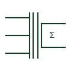

# Summation current transformer

Auxiliary CT with several primary windings that adds the secondary currents of other CTs into one output.

[Canonical reference](https://eloragrid.ai/symbols/summation-current-transformer) · [Structured record](../entries/summation-current-transformer.json) · [All references](README.md)

Updated: 2026-10-28. Drawing use: Schematic, SLD. Reference families: IEC, Manufacturer.

## What it represents

A summation CT has several primary windings, each fed from the secondary of a main CT, and one secondary winding that carries their sum. It lets one meter or relay see the total current of several feeders, or in some relay designs combines three phase currents into a single weighted quantity.
All main CTs feeding a summation CT must have the same ratio, and their polarity must be consistent, otherwise currents cancel instead of adding. The symbol shows the summing arrangement but the burden it adds to each main CT has to be checked separately.

## How to read it

- Check that every feeding CT has the same ratio.
- Verify polarity of each primary winding.

## Drawing checklist

- List feeding CTs
- Show polarity marks
- Check burden on main CTs

## Important distinction

A summation CT adds currents before measurement; a summation energy meter adds energy after measurement.

## Facts

- Inputs: Secondary currents of several main CTs
- Output: Sum of input currents
- Preview: Independent educational concept; consult the applicable standard and project legend for the exact graphic

## Public references

- [Current transformer symbol variants](https://help.autodesk.com/cloudhelp/2021/ENU/AutoCAD-Electrical/files/GUID-40AAEF4A-AC3F-4B3D-90A5-A9E0707C1241.htm) — Autodesk. Public AutoCAD Electrical current transformer family used for context; this variant is independently drawn.
- [Indoor current and voltage transformers](https://www.abb.com/gb/en/areas/electrification/medium-voltage/grid-components/core-components/indoor-instrument-transformers) — ABB. Public manufacturer overview of indoor current and voltage instrument transformers.

## Related references

- [Summation energy meter](summation-energy-meter.md)
- [Interposing current transformer](interposing-current-transformer.md)
- [Current transformer](current-transformer.md)

Original educational concept geometry, CC BY 4.0. Unitless; not a certified standards glyph or manufacturer footprint.

Elora-authored explanations are CC BY 4.0. Linked standards and manufacturer material retain their own rights. Confirm project requirements using primary sources.
