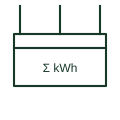

# Summation energy meter

Integrating device that adds energy from several meters or circuits to give one total register.

[Canonical reference](https://eloragrid.ai/symbols/summation-energy-meter) · [Structured record](../entries/summation-energy-meter.json) · [All references](README.md)

Updated: 2026-10-28. Drawing use: SLD, Schematic. Reference families: IEC, Manufacturer.

## What it represents

A summation meter totalises energy from more than one circuit. It may count pulses from several transmitting meters or, in older schemes, be fed by a summation CT, and it appears where several incomers or feeders must be billed or monitored as one supply.
Every input must use the same direction convention and consistent pulse weights, or the total is wrong. The symbol shows the summing function but not the inputs, so each source meter should be listed with its weighting.

## How to read it

- List every meter or circuit that feeds the total.
- Check pulse weights and directions are consistent.

## Drawing checklist

- List input meters
- State weighting per input
- Define direction convention

## Important distinction

A summation meter totals several circuits; a summation CT adds currents before measurement.

## Facts

- Function: Totalises energy from several circuits
- Inputs: Pulse inputs or summated current
- Preview: Independent educational concept; consult the applicable standard and project legend for the exact graphic

## Public references

- [IEC graphical symbols for diagrams](https://tc3.iec.ch/tc-activity/graphical-symbols-for-diagrams/) — IEC. IEC context for graphical symbols used in diagrams; no IEC graphic is reproduced.
- [Power and energy measurement quantities](https://www.se.com/ph/en/faqs/FA343278/) — Schneider Electric. Public explanation of energy and power measurement quantities used by meters.

## Related references

- [Summation current transformer](summation-current-transformer.md)
- [Energy meter with pulse transmitter](energy-meter-with-pulse-transmitter.md)
- [Energy meter repeater](energy-meter-repeater.md)

Original educational concept geometry, CC BY 4.0. Unitless; not a certified standards glyph or manufacturer footprint.

Elora-authored explanations are CC BY 4.0. Linked standards and manufacturer material retain their own rights. Confirm project requirements using primary sources.
