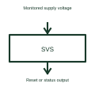

# Supply voltage supervisor

A voltage supervisor checks a supply against specified conditions and produces a status or reset signal.

[Canonical reference](https://eloragrid.ai/symbols/supply-voltage-supervisor) · [Structured record](../entries/supply-voltage-supervisor.json) · [All references](README.md)

Updated: 2026-10-27. Drawing use: Schematic. Reference families: Manufacturer.

## What it represents

A voltage supervisor checks a supply against specified conditions and produces a status or reset signal.
A controller can be held in reset until its monitored supply reaches the required condition.
Connect the monitored rail to the supervisor’s sensing input and label the reset or status output separately. A supervisor checks supply conditions; it does not necessarily regulate the supply itself. Show the output’s destination and the selected assertion/release behaviour. This is original functional artwork, not a certified standard graphic or device pinout.

## How to read it

- Identify the monitored rail and sensing reference.
- Label reset or status output and its destination.
- Reference threshold, delay and output electrical behaviour.
- A supervisor reports or acts on a condition; it is not necessarily the regulator maintaining the voltage.

## Drawing checklist

- Identify the monitored rail and sensing reference.
- Label reset or status output and its destination.
- Reference threshold, delay and output electrical behaviour.

## Important distinction

A supervisor reports or acts on a condition; it is not necessarily the regulator maintaining the voltage.

## Facts

- Representation type: Original functional block; not a certified IEC or IEEE graphic
- Concept input: Monitored supply voltage
- Concept output: Reset or status output

## Public references

- [Supply supervision and reset](https://www.ti.com/product-category/power-management/supervisor-reset-ics/overview.html) — Texas Instruments. Supply supervision and reset: public technical context for the named function. Product and compliance details remain with the publisher.

## Related references

- [Watchdog timer](watchdog-timer.md)
- [Power-good indication](power-good-indication.md)
- [Window voltage supervisor](window-voltage-supervisor.md)
- [Power converter / inverter](power-converter.md)

Original educational concept geometry, CC BY 4.0. Unitless; not a certified standards glyph or manufacturer footprint.

Elora-authored explanations are CC BY 4.0. Linked standards and manufacturer material retain their own rights. Confirm project requirements using primary sources.
