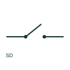

# Switch-disconnector

A switch-disconnector combines operational switching with an isolation function.

[Canonical reference](https://eloragrid.ai/symbols/switch-disconnector) · [Structured record](../entries/switch-disconnector.json) · [All references](README.md)

Updated: 2026-10-27. Drawing use: SLD, Schematic. Reference families: IEC, Manufacturer.

## What it represents

A switch-disconnector combines operational switching with an isolation function. Its designation should distinguish it from a disconnector that is not intended to interrupt load current.

## How to read it

- Check both switching duty and the documented isolation function.
- The preview is an original explanation of this function. Match the actual drawing convention to its legend and the selected equipment documentation.

## Drawing checklist

- Identify utilization category
- Show pole and neutral arrangement
- Document isolation designation

## Important distinction

A load-break switch is not automatically a switch-disconnector; isolation suitability must be documented.

## Facts

- Drawing role: Switching path
- Representation scope: Functional concept; not an official standard graphic or a product footprint
- Public vendor block reference: HDS11Q69, VDS11Q69 (Autodesk identifiers; not IEC symbol numbers)
- Identifier status: The short label is a functional lookup label, not an assigned IEC or IEEE symbol number. Any separately listed Autodesk code is a verified vendor block name.

## Public references

- [AutoCAD Electrical: Disconnector variants](https://help.autodesk.com/cloudhelp/2021/ENU/AutoCAD-Electrical/files/GUID-745AF70A-8A25-4729-AAB7-408A61929B9E.htm) — Autodesk. Public documentation of this equipment function or named vendor variant; the illustration is independently authored and is not the source graphic.
- [Elementary switching devices](https://www.electrical-installation.org/enwiki/Elementary_switching_devices) — Schneider Electric — Electrical Installation Guide. Public documentation of this equipment function or named vendor variant; the illustration is independently authored and is not the source graphic.

## Related references

- [Disconnector](disconnector.md)
- [Circuit breaker](circuit-breaker.md)

Original educational concept geometry, CC BY 4.0. Unitless; not a certified standards glyph or manufacturer footprint.

Elora-authored explanations are CC BY 4.0. Linked standards and manufacturer material retain their own rights. Confirm project requirements using primary sources.
