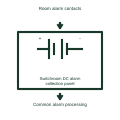

# Switchroom DC alarm collection panel

Collects the assigned DC-operated alarm contacts at the room's supervised alarm interface.

[Canonical reference](https://eloragrid.ai/symbols/switchroom-dc-alarm-collection-panel) · [Structured record](../entries/switchroom-dc-alarm-collection-panel.json) · [All references](README.md)

Updated: 2026-11-03. Drawing use: Schematic. Reference families: Manufacturer.

Representation: functional-block; installation focus: switchrooms.
Room alarm contacts
Common alarm processing

## What it represents

Collects the assigned DC-operated alarm contacts at the room's supervised alarm interface. A room DC interface connects station battery distribution, alarm contacts and operating circuits. DC supplies may remain energized when the room's normal AC supply is unavailable, so their source and distribution boundaries must be shown separately.
In a switchroom, the station battery can continue supplying protection and breaker controls during an AC supply interruption. The alarm system should distinguish charger loss from a low battery condition. For this reference, the drawing identifies “Room alarm contacts” at the input and “Common alarm processing” at the output. Individual alarm causes must remain traceable.
Identify the DC source, returns and monitored branches. Do not infer battery autonomy, conductor polarity, isolation or earthing arrangements from a generic power block. The functional block is an independent explanation of this named application. Equipment-specific ratings, terminal connections and operating conditions must be established in the project documentation.

## How to read it

- Start at the named input: Room alarm contacts. Identify its source device or document and the state represented on the drawing.
- Follow the named output: Common alarm processing. Cross-reference its destination and separate the command from confirmation that the equipment responded.
- Individual alarm causes must remain traceable.
- Identify the DC source, returns and monitored branches. Do not infer battery autonomy, conductor polarity, isolation or earthing arrangements from a generic power block.

## Drawing checklist

- Label the source and connection reference for room alarm contacts.
- Identify the destination and defined state of common alarm processing.
- Record the equipment or control-document revision supporting this functional block.
- Check this application limit in the project design: Individual alarm causes must remain traceable.

## Important distinction

Individual alarm causes must remain traceable. This reference describes the named application; it does not establish a new IEC graphical symbol, an ANSI device-function number or an exact manufacturer connection diagram.

## Facts

- Representation: Functional block
- Installation focus: Switchrooms
- Input / boundary: Room alarm contacts
- Output / connection: Common alarm processing
- Lookup label: SDACP is a library lookup label, not a standard device designation.

## Public references

- [MicroGenius S2/S4 battery charger technical manual](https://www.sens-usa.com/hubfs/Controlled%20Files/Manuals/101330_MGS_User_Manual.pdf) — SENS. Public technical context for switchroom dc interfaces and alarm collection. Battery charging modes, DC distribution interfaces and charger alarms. The application text and educational graphic are independently authored; the publisher does not certify this representation.

## Related references

- [Station DC battery rack](ga-station-dc-battery-rack.md)
- [Battery charger controller](battery-charger-controller.md)
- [Switchroom station-DC incoming interface](switchroom-station-dc-incoming-interface.md)

Original educational concept geometry, CC BY 4.0. Unitless; not a certified standards glyph or manufacturer footprint.

Elora-authored explanations are CC BY 4.0. Linked standards and manufacturer material retain their own rights. Confirm project requirements using primary sources.
