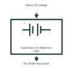

# Switchroom DC feeder-loss input

Reports loss of the assigned incoming DC feeder at its monitored room boundary.

[Canonical reference](https://eloragrid.ai/symbols/switchroom-dc-feeder-loss-input) · [Structured record](../entries/switchroom-dc-feeder-loss-input.json) · [All references](README.md)

Updated: 2026-11-03. Drawing use: Schematic. Reference families: Manufacturer.

Representation: functional-block; installation focus: switchrooms.
Room DC voltage
DC feeder-loss alarm

## What it represents

Reports loss of the assigned incoming DC feeder at its monitored room boundary. A room DC interface connects station battery distribution, alarm contacts and operating circuits. DC supplies may remain energized when the room's normal AC supply is unavailable, so their source and distribution boundaries must be shown separately.
In a switchroom, the station battery can continue supplying protection and breaker controls during an AC supply interruption. The alarm system should distinguish charger loss from a low battery condition. For this reference, the drawing identifies “Room DC voltage” at the input and “DC feeder-loss alarm” at the output. The monitoring circuit needs a dependable alarm path.
Identify the DC source, returns and monitored branches. Do not infer battery autonomy, conductor polarity, isolation or earthing arrangements from a generic power block. The functional block is an independent explanation of this named application. Equipment-specific ratings, terminal connections and operating conditions must be established in the project documentation.

## How to read it

- Start at the named input: Room DC voltage. Identify its source device or document and the state represented on the drawing.
- Follow the named output: DC feeder-loss alarm. Cross-reference its destination and separate the command from confirmation that the equipment responded.
- The monitoring circuit needs a dependable alarm path.
- Identify the DC source, returns and monitored branches. Do not infer battery autonomy, conductor polarity, isolation or earthing arrangements from a generic power block.

## Drawing checklist

- Label the source and connection reference for room dc voltage.
- Identify the destination and defined state of dc feeder-loss alarm.
- Record the equipment or control-document revision supporting this functional block.
- Check this application limit in the project design: The monitoring circuit needs a dependable alarm path.

## Important distinction

The monitoring circuit needs a dependable alarm path. This reference describes the named application; it does not establish a new IEC graphical symbol, an ANSI device-function number or an exact manufacturer connection diagram.

## Facts

- Representation: Functional block
- Installation focus: Switchrooms
- Input / boundary: Room DC voltage
- Output / connection: DC feeder-loss alarm
- Lookup label: SDFI is a library lookup label, not a standard device designation.

## Public references

- [MicroGenius S2/S4 battery charger technical manual](https://www.sens-usa.com/hubfs/Controlled%20Files/Manuals/101330_MGS_User_Manual.pdf) — SENS. Public technical context for switchroom dc interfaces and alarm collection. Battery charging modes, DC distribution interfaces and charger alarms. The application text and educational graphic are independently authored; the publisher does not certify this representation.

## Related references

- [Station DC battery rack](ga-station-dc-battery-rack.md)
- [Battery charger controller](battery-charger-controller.md)
- [Switchroom alarm supply redundancy interface](switchroom-alarm-supply-redundancy-interface.md)

Original educational concept geometry, CC BY 4.0. Unitless; not a certified standards glyph or manufacturer footprint.

Elora-authored explanations are CC BY 4.0. Linked standards and manufacturer material retain their own rights. Confirm project requirements using primary sources.
