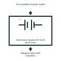

# Switchroom negative-DC earth alarm input

Receives the insulation-monitor indication associated with the negative side of the assigned DC system.

[Canonical reference](https://eloragrid.ai/symbols/switchroom-negative-dc-earth-alarm-input) · [Structured record](../entries/switchroom-negative-dc-earth-alarm-input.json) · [All references](README.md)

Updated: 2026-11-03. Drawing use: Schematic. Reference families: Manufacturer.

Representation: functional-block; installation focus: switchrooms.
DC insulation-monitor output
Negative-side earth indication

## What it represents

Receives the insulation-monitor indication associated with the negative side of the assigned DC system. A room DC interface connects station battery distribution, alarm contacts and operating circuits. DC supplies may remain energized when the room's normal AC supply is unavailable, so their source and distribution boundaries must be shown separately.
In a switchroom, the station battery can continue supplying protection and breaker controls during an AC supply interruption. The alarm system should distinguish charger loss from a low battery condition. For this reference, the drawing identifies “DC insulation-monitor output” at the input and “Negative-side earth indication” at the output. Alarm polarity depends on the monitoring implementation.
Identify the DC source, returns and monitored branches. Do not infer battery autonomy, conductor polarity, isolation or earthing arrangements from a generic power block. The functional block is an independent explanation of this named application. Equipment-specific ratings, terminal connections and operating conditions must be established in the project documentation.

## How to read it

- Start at the named input: DC insulation-monitor output. Identify its source device or document and the state represented on the drawing.
- Follow the named output: Negative-side earth indication. Cross-reference its destination and separate the command from confirmation that the equipment responded.
- Alarm polarity depends on the monitoring implementation.
- Identify the DC source, returns and monitored branches. Do not infer battery autonomy, conductor polarity, isolation or earthing arrangements from a generic power block.

## Drawing checklist

- Label the source and connection reference for dc insulation-monitor output.
- Identify the destination and defined state of negative-side earth indication.
- Record the equipment or control-document revision supporting this functional block.
- Check this application limit in the project design: Alarm polarity depends on the monitoring implementation.

## Important distinction

Alarm polarity depends on the monitoring implementation. This reference describes the named application; it does not establish a new IEC graphical symbol, an ANSI device-function number or an exact manufacturer connection diagram.

## Facts

- Representation: Functional block
- Installation focus: Switchrooms
- Input / boundary: DC insulation-monitor output
- Output / connection: Negative-side earth indication
- Lookup label: SNEAI is a library lookup label, not a standard device designation.

## Public references

- [MicroGenius S2/S4 battery charger technical manual](https://www.sens-usa.com/hubfs/Controlled%20Files/Manuals/101330_MGS_User_Manual.pdf) — SENS. Public technical context for switchroom dc interfaces and alarm collection. Battery charging modes, DC distribution interfaces and charger alarms. The application text and educational graphic are independently authored; the publisher does not certify this representation.

## Related references

- [Station DC battery rack](ga-station-dc-battery-rack.md)
- [Battery charger controller](battery-charger-controller.md)
- [Switchroom charger-failure input](switchroom-charger-failure-input.md)

Original educational concept geometry, CC BY 4.0. Unitless; not a certified standards glyph or manufacturer footprint.

Elora-authored explanations are CC BY 4.0. Linked standards and manufacturer material retain their own rights. Confirm project requirements using primary sources.
