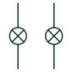

# Synchronising lamps

Set of lamps connected between incoming and running phases that brighten and dim with the phase difference during synchronising.

[Canonical reference](https://eloragrid.ai/symbols/synchronising-lamps) · [Structured record](../entries/synchronising-lamps.json) · [All references](README.md)

Updated: 2026-10-28. Drawing use: Schematic. Reference families: IEC, Manufacturer.

## What it represents

Synchronising lamps are connected between corresponding phases of the running system and the incoming machine. As the phase difference changes the lamps brighten and dim, and in the dark-lamp method the breaker is closed when they are dark, showing the voltages are in phase.
Lamps cannot show small residual voltage differences reliably, since a lamp can look dark with a significant voltage across it. They are therefore a backup or visual aid, and the drawing should show a synchroscope or check-synchronising relay for the actual permission to close.

## How to read it

- Identify which phases each lamp is connected across.
- Look for a check-synchronising relay in the closing circuit.

## Drawing checklist

- Show lamp connections per phase
- State lamp voltage rating
- Reference check-synchronising function

## Important distinction

Synchronising lamps give a visual indication; a synchroscope shows phase angle and slip direction directly.

## Facts

- Connection: Across incoming and running phases
- Common method: Dark-lamp closing
- Preview: Independent educational concept; consult the applicable standard and project legend for the exact graphic

## Public references

- [IEC graphical symbols for diagrams](https://tc3.iec.ch/tc-activity/graphical-symbols-for-diagrams/) — IEC. IEC context for graphical symbols used in diagrams; no IEC graphic is reproduced.
- [Generator switchgear and paralleling controls](https://www.cummins.com/en-na/generators/products/switchgear) — Cummins. Public generator paralleling controls context.

## Related references

- [Synchronoscope](synchronoscope.md)
- [Double voltmeter](double-voltmeter.md)
- [Synchronism check](25-synchronism-check.md)

Original educational concept geometry, CC BY 4.0. Unitless; not a certified standards glyph or manufacturer footprint.

Elora-authored explanations are CC BY 4.0. Linked standards and manufacturer material retain their own rights. Confirm project requirements using primary sources.
