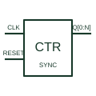

# Synchronous binary counter

Updates its binary count from a common clock with the documented count-enable, load and clear controls.

[Canonical reference](https://eloragrid.ai/symbols/synchronous-binary-counter) · [Structured record](../entries/synchronous-binary-counter.json) · [All references](README.md)

Updated: 2026-10-27. Drawing use: Schematic. Reference families: Manufacturer.

## What it represents

Updates its binary count from a common clock with the documented count-enable, load and clear controls.
On a schematic, identify the common clock, enables, load data and reset timing and trace the count outputs and carry/cascade signal. Keep the component tag and signal/reference names consistent across the control drawing, terminal schedule and device documentation.
Synchronous operation does not remove setup/hold and output-delay requirements; reset can be synchronous or asynchronous depending on the part.
The preview is an independently drawn educational functional reference. Add the selected component’s actual power pins, terminal numbers, timing or analogue reference details when producing a construction drawing.

## How to read it

- Identify the common clock, enables, load data and reset timing.
- Trace the count outputs and carry/cascade signal.

## Drawing checklist

- Label the common clock, enables, load data and reset timing.
- Cross-reference the count outputs and carry/cascade signal.
- Add the selected device or circuit documentation revision, power/reference connections and project signal convention.

## Important distinction

Synchronous operation does not remove setup/hold and output-delay requirements; reset can be synchronous or asynchronous depending on the part.

## Facts

- Common schematic mnemonic: CTR-SYNC — descriptive only; project/device documentation defines reference designations.
- Terminal / interface focus: The common clock, enables, load data and reset timing
- Artwork scope: Original educational functional/circuit reference; not a selected product pinout.

## Public references

- [SN74HC163 — synchronous binary counters](https://www.ti.com/lit/ds/symlink/sn74hc163.pdf) — Texas Instruments. Public primary manufacturer documentation establishes the component function or circuit/topology relationship. Preview geometry and drafting explanations are independently authored.

## Related references

- [Ripple binary counter](ripple-binary-counter.md)
- [PLC input / output](plc-io.md)

Original educational concept geometry, CC BY 4.0. Unitless; not a certified standards glyph or manufacturer footprint.

Elora-authored explanations are CC BY 4.0. Linked standards and manufacturer material retain their own rights. Confirm project requirements using primary sources.
