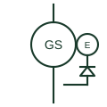

# Synchronous generator with brushless exciter

A synchronous alternator shown with its exciter machine and rotating rectifier, as used on most generating sets.

[Canonical reference](https://eloragrid.ai/symbols/synchronous-generator-with-brushless-exciter) · [Structured record](../entries/synchronous-generator-with-brushless-exciter.json) · [All references](README.md)

Updated: 2026-10-28. Drawing use: SLD, Schematic. Reference families: IEC, IEEE / ANSI.

## What it represents

Most modern generating sets use a brushless excitation system: a small exciter generator on the same shaft feeds a rotating diode rectifier, which supplies DC to the main field without slip rings. The automatic voltage regulator controls the exciter field, and some sets add a permanent-magnet pilot exciter to power the regulator independently of the output voltage.
Schematics draw the main generator circle, a smaller exciter circle on the same shaft line and a rectifier bridge between them, with the regulator connected to the exciter field. Single-line diagrams often reduce this to the main machine with a note, so the expanded form usually appears on the generator control schematic.
The symbol does not give the regulator type, the excitation support during short circuits, or whether a pilot exciter is fitted. Those determine whether the set can sustain fault current long enough for downstream protection to operate.

## How to read it

- The rotating rectifier is shown inside the shaft boundary; it is not an external rectifier.
- A permanent-magnet pilot exciter indicates excitation support independent of terminal voltage.

## Drawing checklist

- Identify regulator type and sensing connections.
- State pilot exciter presence.
- Reference fault-current support data.

## Important distinction

This form shows the excitation chain explicitly; the plain synchronous generator symbol shows only the main machine.

## Facts

- Excitation path: Exciter, rotating rectifier, main field
- Regulator input: Exciter field current
- Slip rings: None
- Preview: Independent educational illustration; consult the applicable standard and project legend for the exact graphic

## Public references

- [T-030 liquid-cooled generator set application manual](https://www.cummins.com/sites/default/files/2024-08/t030-Liquid-cooled-gen-set-application-manual.pdf) — Cummins. Public generator-set application manual describing alternator excitation arrangements.
- [Generator symbol variants](https://help.autodesk.com/cloudhelp/2021/ENU/AutoCAD-Electrical/files/GUID-09BE3BB5-9118-4302-8061-3888692E538F.htm) — Autodesk. Public synchronous generator symbol variants.

## Related references

- [Three-phase synchronous generator](three-phase-synchronous-generator.md)
- [Diesel generator set](diesel-generator-set.md)
- [Single-phase bridge rectifier](single-phase-bridge-rectifier.md)
- [Exciter or DC generator relay](53-exciter-or-dc-generator-relay.md)

Original educational concept geometry, CC BY 4.0. Unitless; not a certified standards glyph or manufacturer footprint.

Elora-authored explanations are CC BY 4.0. Linked standards and manufacturer material retain their own rights. Confirm project requirements using primary sources.
