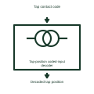

# Tap-position coded-input decoder

Converts the installed tap-position contact code into the controller's displayed position.

[Canonical reference](https://eloragrid.ai/symbols/tap-position-coded-input-decoder) · [Structured record](../entries/tap-position-coded-input-decoder.json) · [All references](README.md)

Updated: 2026-11-03. Drawing use: Schematic. Reference families: Manufacturer.

Representation: functional-block; installation focus: substations.
Tap contact code
Decoded tap position

## What it represents

Converts the installed tap-position contact code into the controller's displayed position. Transformer regulation changes the selected winding connection to influence voltage, while cooling control manages the installed fans and pumps. Commands, mechanical position and measured results belong to different parts of the diagram.
In a substation, a voltage regulator can request a tap change and check the resulting tap-position feedback. A separate controller stages cooling equipment according to the transformer manufacturer's defined conditions. For this reference, the drawing identifies “Tap contact code” at the input and “Decoded tap position” at the output. Invalid codes require explicit handling.
Keep tap-change permission, limit contacts, movement indication and measured voltage distinct. Actual tap positions, time delays, cooling ratings and allowable parallel operation require the selected transformer control design. The functional block is an independent explanation of this named application. Equipment-specific ratings, terminal connections and operating conditions must be established in the project documentation.

## How to read it

- Start at the named input: Tap contact code. Identify its source device or document and the state represented on the drawing.
- Follow the named output: Decoded tap position. Cross-reference its destination and separate the command from confirmation that the equipment responded.
- Invalid codes require explicit handling.
- Keep tap-change permission, limit contacts, movement indication and measured voltage distinct. Actual tap positions, time delays, cooling ratings and allowable parallel operation require the selected transformer control design.

## Drawing checklist

- Label the source and connection reference for tap contact code.
- Identify the destination and defined state of decoded tap position.
- Record the equipment or control-document revision supporting this functional block.
- Check this application limit in the project design: Invalid codes require explicit handling.

## Important distinction

Invalid codes require explicit handling. This reference describes the named application; it does not establish a new IEC graphical symbol, an ANSI device-function number or an exact manufacturer connection diagram.

## Facts

- Representation: Functional block
- Installation focus: Substations
- Input / boundary: Tap contact code
- Output / connection: Decoded tap position
- Lookup label: TCD is a library lookup label, not a standard device designation.

## Public references

- [SEL-2414 transformer monitor](https://selinc.com/products/2414/) — SEL. Public technical context for transformer regulation and cooling control. Transformer temperature, cooling, tap changing and parallel operation. The application text and educational graphic are independently authored; the publisher does not certify this representation.

## Related references

- [Adjustable-ratio transformer](adjustable-ratio-transformer.md)
- [Winding temperature indicator](winding-temperature-indicator.md)
- [Tap-position analogue-input interface](tap-position-analogue-input-interface.md)

Original educational concept geometry, CC BY 4.0. Unitless; not a certified standards glyph or manufacturer footprint.

Elora-authored explanations are CC BY 4.0. Linked standards and manufacturer material retain their own rights. Confirm project requirements using primary sources.
