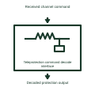

# Teleprotection command decode interface

Maps the accepted received channel message to its assigned local protection contact or data output.

[Canonical reference](https://eloragrid.ai/symbols/teleprotection-command-decode-interface) · [Structured record](../entries/teleprotection-command-decode-interface.json) · [All references](README.md)

Updated: 2026-11-03. Drawing use: Schematic. Reference families: Manufacturer.

Representation: functional-block; installation focus: switchyards.
Received channel command
Decoded protection output

## What it represents

Maps the accepted received channel message to its assigned local protection contact or data output. A protection communication interface carries information between circuit ends or couples a communication signal to a primary line. Its signal path is different from the power-current path even when both use part of the same installation.
In a switchyard line bay, carrier-coupling equipment can connect a protection communication terminal to the transmission conductor. Fiber-based protection uses another physical path but still needs named endpoints and channel supervision. For this reference, the drawing identifies “Received channel command” at the input and “Decoded protection output” at the output. Quality and unwanted-command handling require definition.
Show each coupling boundary and the intended information direction. Frequency selection, channel performance, insulation duty and protective coordination require the selected communication and primary equipment design. The functional block is an independent explanation of this named application. Equipment-specific ratings, terminal connections and operating conditions must be established in the project documentation.

## How to read it

- Start at the named input: Received channel command. Identify its source device or document and the state represented on the drawing.
- Follow the named output: Decoded protection output. Cross-reference its destination and separate the command from confirmation that the equipment responded.
- Quality and unwanted-command handling require definition.
- Show each coupling boundary and the intended information direction. Frequency selection, channel performance, insulation duty and protective coordination require the selected communication and primary equipment design.

## Drawing checklist

- Label the source and connection reference for received channel command.
- Identify the destination and defined state of decoded protection output.
- Record the equipment or control-document revision supporting this functional block.
- Check this application limit in the project design: Quality and unwanted-command handling require definition.

## Important distinction

Quality and unwanted-command handling require definition. This reference describes the named application; it does not establish a new IEC graphical symbol, an ANSI device-function number or an exact manufacturer connection diagram.

## Facts

- Representation: Functional block
- Installation focus: Switchyards
- Input / boundary: Received channel command
- Output / connection: Decoded protection output
- Lookup label: TCDI is a library lookup label, not a standard device designation.

## Public references

- [Line traps: power-line carrier communication](https://www.gevernova.com/grid-solutions/sites/default/files/2025-09/Line-Traps-Brochure-EN-N50059-Hybrid-202504-R002.pdf) — GE Vernova. Public technical context for line carrier and protection communication interfaces. Line traps, coupling and power-line carrier communications. The application text and educational graphic are independently authored; the publisher does not certify this representation.

## Related references

- [Capacitor voltage transformer](capacitor-voltage-transformer.md)
- [Pilot or carrier receiver relay](85-pilot-or-carrier-receiver-relay.md)
- [Protection channel latency-monitor interface](protection-channel-latency-monitor-interface.md)

Original educational concept geometry, CC BY 4.0. Unitless; not a certified standards glyph or manufacturer footprint.

Elora-authored explanations are CC BY 4.0. Linked standards and manufacturer material retain their own rights. Confirm project requirements using primary sources.
