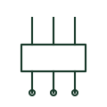

# Test plug

Plug inserted into a test block or switch to connect test equipment to the relay side while isolating the plant side.

[Canonical reference](https://eloragrid.ai/symbols/test-plug) · [Structured record](../entries/test-plug.json) · [All references](README.md)

Updated: 2026-10-28. Drawing use: Schematic. Reference families: Manufacturer.

## What it represents

A test plug fits into a test block or test switch and brings each pole out to test leads. Depending on its design it can connect test equipment to the relay side only, or link plant and relay sides through an ammeter for in-service current measurement.
Different plug types for the same block do different things, so the procedure must name the plug variant. The symbol shows the plug's poles but not its internal links, and using the wrong plug can open a live CT circuit or leave a trip output connected.

## How to read it

- Check which plug variant the procedure requires.
- Read the internal links of each pole.

## Drawing checklist

- Name plug variant
- Show internal links
- Match pole numbers to the block

## Important distinction

A test plug is the removable part; the test block or switch is the fixed part wired into the circuit.

## Facts

- Function: Connects test equipment through a test block
- Variants: Isolating and in-service measuring types
- Preview: Functional illustration of the device role; not a product footprint or certified standard graphic

## Public references

- [Transformer terminals for measuring and test circuits](https://www.phoenixcontact.com/en-ie/products/terminal-blocks/transformer-terminal-blocks?p=7) — Phoenix Contact. Public manufacturer range of transformer and test terminals for measuring and protection circuits.

## Related references

- [Relay test block](relay-test-block.md)
- [Current test switch with shorting contact](current-test-switch-with-shorting.md)
- [CT test terminal](ct-test-terminal.md)

Original educational concept geometry, CC BY 4.0. Unitless; not a certified standards glyph or manufacturer footprint.

Elora-authored explanations are CC BY 4.0. Linked standards and manufacturer material retain their own rights. Confirm project requirements using primary sources.
