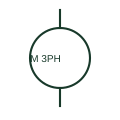

# Three-phase AC motor

A three-phase AC motor is a load supplied from three documented phases.

[Canonical reference](https://eloragrid.ai/symbols/three-phase-ac-motor) · [Structured record](../entries/three-phase-ac-motor.json) · [All references](README.md)

Updated: 2026-10-27. Drawing use: SLD, Schematic. Reference families: IEC, Manufacturer.

## What it represents

A three-phase AC motor is a load supplied from three documented phases. Its winding connections, protection and starter are recorded in the power schematic or linked motor data.

## How to read it

- Check whether the drawing shows a simplified load or an expanded terminal connection.
- The preview is an original explanation of this function. Match the actual drawing convention to its legend and the selected equipment documentation.

## Drawing checklist

- State supply and rating
- Reference winding connection
- Show starter and overload protection

## Important distinction

A three-phase motor representation does not specify star or delta terminal links by itself.

## Facts

- Drawing role: Rotating or linear load
- Representation scope: Functional concept; not an official standard graphic or a product footprint
- Public vendor block reference: HMO13, VMO13 (Autodesk identifiers; not IEC symbol numbers)
- Identifier status: The short label is a functional lookup label, not an assigned IEC or IEEE symbol number. Any separately listed Autodesk code is a verified vendor block name.

## Public references

- [Three-phase motor symbol variants](https://help.autodesk.com/cloudhelp/2021/ENU/AutoCAD-Electrical/files/GUID-385CBE83-33A3-4314-913E-3B59A6D05F22.htm) — Autodesk. Public documentation of this equipment function or named vendor variant; the illustration is independently authored and is not the source graphic.

## Related references

- [Three-phase motor](motor.md)
- [Contactor](contactor.md)

Original educational concept geometry, CC BY 4.0. Unitless; not a certified standards glyph or manufacturer footprint.

Elora-authored explanations are CC BY 4.0. Linked standards and manufacturer material retain their own rights. Confirm project requirements using primary sources.
