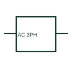

# Three-phase AC source

A three-phase AC source identifies a documented three-phase supply boundary.

[Canonical reference](https://eloragrid.ai/symbols/three-phase-ac-source) · [Structured record](../entries/three-phase-ac-source.json) · [All references](README.md)

Updated: 2026-10-27. Drawing use: SLD, Schematic. Reference families: IEC, Manufacturer.

## What it represents

A three-phase AC source identifies a documented three-phase supply boundary. Its nominal voltage, phase sequence and neutral availability must be stated where the design relies on them.

## How to read it

- Locate the source boundary before interpreting upstream ownership or available fault data.
- The preview is an original explanation of this function. Match the actual drawing convention to its legend and the selected equipment documentation.

## Drawing checklist

- Name supply origin
- State voltage and phase sequence
- Reference neutral/earthing arrangement

## Important distinction

Three-phase source designation does not establish an accessible neutral conductor.

## Facts

- Drawing role: Supply or network role
- Representation scope: Functional concept; not an official standard graphic or a product footprint
- Public vendor block reference: HPW1\_3PH, VPW1\_3PH (Autodesk identifiers; not IEC symbol numbers)
- Identifier status: The short label is a functional lookup label, not an assigned IEC or IEEE symbol number. Any separately listed Autodesk code is a verified vendor block name.

## Public references

- [AutoCAD Electrical: Earthing, sources and surge protection](https://help.autodesk.com/cloudhelp/2021/ENU/AutoCAD-Electrical/files/GUID-1E3FDEAE-B4B2-417C-8075-108AA2C6E509.htm) — Autodesk. Public documentation of this equipment function or named vendor variant; the illustration is independently authored and is not the source graphic.

## Related references

- [Generator](generator.md)
- [Busbar](busbar.md)

Original educational concept geometry, CC BY 4.0. Unitless; not a certified standards glyph or manufacturer footprint.

Elora-authored explanations are CC BY 4.0. Linked standards and manufacturer material retain their own rights. Confirm project requirements using primary sources.
