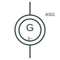

# Three-phase induction generator

A squirrel-cage asynchronous machine driven above synchronous speed so that it delivers power into a three-phase network.

[Canonical reference](https://eloragrid.ai/symbols/three-phase-induction-generator) · [Structured record](../entries/three-phase-induction-generator.json) · [All references](README.md)

Updated: 2026-10-28. Drawing use: SLD, Schematic. Reference families: IEC, IEEE / ANSI.

## What it represents

An induction generator is an asynchronous machine driven slightly faster than synchronous speed by a turbine or engine. It exports active power but needs reactive power from the network or from capacitors to establish its magnetic field, so it cannot normally hold voltage and frequency on its own.
The symbol is a machine circle with G, a three-phase AC mark and often the letters ASG or a squirrel-cage indication to separate it from a synchronous generator. It is found in small hydro, older wind turbines and some biogas or heat recovery sets connected in parallel with a stronger supply.
The symbol does not tell you whether the machine can run isolated with self-excitation capacitors, or what happens to its output when the network trips. Islanded operation and reverse power or loss-of-mains protection have to be read from the protection and control drawings.

## How to read it

- Look for excitation capacitors near the machine terminals.
- Check loss-of-mains protection, since the machine may self-excite on capacitors if islanded.

## Drawing checklist

- State rating, voltage and rated slip.
- Show capacitor compensation and its switching.
- Reference loss-of-mains protection.

## Important distinction

An induction generator draws its magnetising current from the network; a synchronous generator has its own field and can regulate voltage.

## Facts

- Excitation: From network or capacitors
- Operating speed: Slightly above synchronous
- Island capability: Not inherent
- Preview: Independent educational illustration; consult the applicable standard and project legend for the exact graphic

## Public references

- [Three-phase motor symbol variants](https://help.autodesk.com/cloudhelp/2021/ENU/AutoCAD-Electrical/files/GUID-385CBE83-33A3-4314-913E-3B59A6D05F22.htm) — Autodesk. Public three-phase induction machine symbol family; the generator mark is added in this original illustration.
- [IEEE/ANSI 315-1975: graphic symbols for electrical and electronics diagrams](https://standards.ieee.org/ieee/315/515/) — IEEE Standards Association. Graphic-symbol standards context for rotating machines.

## Related references

- [Three-phase synchronous generator](three-phase-synchronous-generator.md)
- [Fixed-speed wind turbine generator (Type 1)](type-1-fixed-speed-wind-turbine-generator.md)
- [Three-phase AC motor](three-phase-ac-motor.md)
- [Generator](generator.md)

Original educational concept geometry, CC BY 4.0. Unitless; not a certified standards glyph or manufacturer footprint.

Elora-authored explanations are CC BY 4.0. Linked standards and manufacturer material retain their own rights. Confirm project requirements using primary sources.
