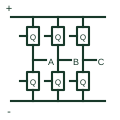

# Three-phase sixpack power module

A power module containing three switching legs for a three-phase bridge arrangement.

[Canonical reference](https://eloragrid.ai/symbols/three-phase-sixpack-power-module) · [Structured record](../entries/three-phase-sixpack-power-module.json) · [All references](README.md)

Updated: 2026-10-27. Drawing use: Schematic. Reference families: Manufacturer.

## What it represents

A power module containing three switching legs for a three-phase bridge arrangement.
On a schematic, identify the DC-link terminals, three phase midpoints and six gate-drive circuits and trace the inverter phase connections and sensing/driver returns. Keep the component tag and signal/reference names consistent across the control drawing, terminal schedule and device documentation.
A sixpack describes the switching arrangement; it is not a guarantee of integrated control, isolation or protection electronics.
Terminal letters describe electrical roles, not package pin numbers. Check the selected public datasheet for the actual pin assignment, polarity and any internally connected terminals before completing the drawing.

## How to read it

- Identify the DC-link terminals, three phase midpoints and six gate-drive circuits.
- Trace the inverter phase connections and sensing/driver returns.

## Drawing checklist

- Label the DC-link terminals, three phase midpoints and six gate-drive circuits.
- Cross-reference the inverter phase connections and sensing/driver returns.
- Add the selected device or circuit documentation revision, power/reference connections and project signal convention.

## Important distinction

A sixpack describes the switching arrangement; it is not a guarantee of integrated control, isolation or protection electronics.

## Facts

- Common schematic mnemonic: 6-PACK — descriptive only; project/device documentation defines reference designations.
- Terminal / interface focus: The DC-link terminals, three phase midpoints and six gate-drive circuits
- Artwork scope: Original educational component glyph; not a certified standard graphic or package pinout.

## Public references

- [Power semiconductor module families](https://www.infineon.com/products/power/modules) — Infineon Technologies. Public primary manufacturer documentation establishes the component function or circuit/topology relationship. Preview geometry and drafting explanations are independently authored.

## Related references

- [Half-bridge power module](half-bridge-power-module.md)
- [Diode](diode.md)

Original educational concept geometry, CC BY 4.0. Unitless; not a certified standards glyph or manufacturer footprint.

Elora-authored explanations are CC BY 4.0. Linked standards and manufacturer material retain their own rights. Confirm project requirements using primary sources.
