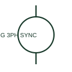

# Three-phase synchronous generator

A three-phase synchronous generator supplies a documented AC source associated with its mechanical prime mover and excitation system.

[Canonical reference](https://eloragrid.ai/symbols/three-phase-synchronous-generator) · [Structured record](../entries/three-phase-synchronous-generator.json) · [All references](README.md)

Updated: 2026-10-27. Drawing use: SLD, Schematic. Reference families: IEC, Manufacturer.

## What it represents

A three-phase synchronous generator supplies a documented AC source associated with its mechanical prime mover and excitation system. The electrical drawing identifies terminals, neutral and generator-control connections.

## How to read it

- Locate the voltage/current measurement points used by the generator controls.
- The preview is an original explanation of this function. Match the actual drawing convention to its legend and the selected equipment documentation.

## Drawing checklist

- State output and winding ratings
- Show neutral arrangement
- Reference excitation and protection

## Important distinction

The electrical generator representation is different from the complete mechanical generator package envelope.

## Facts

- Drawing role: Generating source
- Representation scope: Functional concept; not an official standard graphic or a product footprint
- Public vendor block reference: HPW1G7, VPW1G7 (Autodesk identifiers; not IEC symbol numbers)
- Identifier status: The short label is a functional lookup label, not an assigned IEC or IEEE symbol number. Any separately listed Autodesk code is a verified vendor block name.

## Public references

- [Generator symbol variants](https://help.autodesk.com/cloudhelp/2021/ENU/AutoCAD-Electrical/files/GUID-09BE3BB5-9118-4302-8061-3888692E538F.htm) — Autodesk. Public documentation of this equipment function or named vendor variant; the illustration is independently authored and is not the source graphic.

## Related references

- [Generator](generator.md)
- [Synchronism check](25-synchronism-check.md)

Original educational concept geometry, CC BY 4.0. Unitless; not a certified standards glyph or manufacturer footprint.

Elora-authored explanations are CC BY 4.0. Linked standards and manufacturer material retain their own rights. Confirm project requirements using primary sources.
