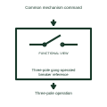

# Three-pole gang-operated breaker reference

Identifies a mechanism arrangement coordinating all three poles through its documented operation.

[Canonical reference](https://eloragrid.ai/symbols/three-pole-gang-operated-breaker-reference) · [Structured record](../entries/three-pole-gang-operated-breaker-reference.json) · [All references](README.md)

Updated: 2026-11-03. Drawing use: Schematic. Reference families: Manufacturer.

Representation: functional-block; installation focus: switchgear.
Common mechanism command
Three-pole operation

## What it represents

Identifies a mechanism arrangement coordinating all three poles through its documented operation. A switching-device operating reference adds the specific mechanism or duty context needed to interpret its place in a power circuit. The same basic switching outline can serve different equipment constructions, so the added description must remain attached to its device tag.
In a medium-voltage switchgear drawing, the operating reference helps the reader distinguish the interrupting device from its isolation, earthing and auxiliary-control interfaces. For this reference, the drawing identifies “Common mechanism command” at the input and “Three-pole operation” at the output. Simultaneous command does not imply identical contact timing.
Use the device schedule for its actual construction, operating duty and ratings. These original functional illustrations describe the named role and do not certify a standard glyph or product footprint. The functional block is an independent explanation of this named application. Equipment-specific ratings, terminal connections and operating conditions must be established in the project documentation.

## How to read it

- Start at the named input: Common mechanism command. Identify its source device or document and the state represented on the drawing.
- Follow the named output: Three-pole operation. Cross-reference its destination and separate the command from confirmation that the equipment responded.
- Simultaneous command does not imply identical contact timing.
- Use the device schedule for its actual construction, operating duty and ratings. These original functional illustrations describe the named role and do not certify a standard glyph or product footprint.

## Drawing checklist

- Label the source and connection reference for common mechanism command.
- Identify the destination and defined state of three-pole operation.
- Record the equipment or control-document revision supporting this functional block.
- Check this application limit in the project design: Simultaneous command does not imply identical contact timing.

## Important distinction

Simultaneous command does not imply identical contact timing. This reference describes the named application; it does not establish a new IEC graphical symbol, an ANSI device-function number or an exact manufacturer connection diagram.

## Facts

- Representation: Functional block
- Installation focus: Switchgear
- Input / boundary: Common mechanism command
- Output / connection: Three-pole operation
- Lookup label: TGBR is a library lookup label, not a standard device designation.

## Public references

- [High-voltage circuit breakers](https://www.siemens-energy.com/global/en/home/products-services/product-offerings/circuit-breakers.html) — Siemens Energy. Public technical context for switching-device operating references. Circuit-breaker construction and interruption families. The application text and educational graphic are independently authored; the publisher does not certify this representation.

## Related references

- [Circuit breaker](circuit-breaker.md)
- [Disconnector](disconnector.md)
- [Magnetically latched operating mechanism reference](magnetically-latched-operating-mechanism-reference.md)

Original educational concept geometry, CC BY 4.0. Unitless; not a certified standards glyph or manufacturer footprint.

Elora-authored explanations are CC BY 4.0. Linked standards and manufacturer material retain their own rights. Confirm project requirements using primary sources.
