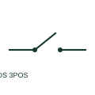

# Three-position disconnector

A three-position disconnector selects between two paths and an intermediate position.

[Canonical reference](https://eloragrid.ai/symbols/three-position-disconnector) · [Structured record](../entries/three-position-disconnector.json) · [All references](README.md)

Updated: 2026-10-27. Drawing use: SLD, Schematic. Reference families: IEC, Manufacturer.

## What it represents

A three-position disconnector selects between two paths and an intermediate position. Switchgear schematics must define each position and any linked earth or isolation function explicitly.

## How to read it

- The middle position must be labelled rather than assumed to be open or earthed.
- The preview is an original explanation of this function. Match the actual drawing convention to its legend and the selected equipment documentation.

## Drawing checklist

- Name all three positions
- Draw each connected path
- Reference mechanical interlocks

## Important distinction

Three positions describe available states; they do not imply that every transition can occur under load.

## Facts

- Drawing role: Switching path
- Representation scope: Functional concept; not an official standard graphic or a product footprint
- Public vendor block reference: HDS11Q89, VDS11Q89 (Autodesk identifiers; not IEC symbol numbers)
- Identifier status: The short label is a functional lookup label, not an assigned IEC or IEEE symbol number. Any separately listed Autodesk code is a verified vendor block name.

## Public references

- [AutoCAD Electrical: Disconnector variants](https://help.autodesk.com/cloudhelp/2021/ENU/AutoCAD-Electrical/files/GUID-745AF70A-8A25-4729-AAB7-408A61929B9E.htm) — Autodesk. Public documentation of this equipment function or named vendor variant; the illustration is independently authored and is not the source graphic.
- [Elementary switching devices](https://www.electrical-installation.org/enwiki/Elementary_switching_devices) — Schneider Electric — Electrical Installation Guide. Public documentation of this equipment function or named vendor variant; the illustration is independently authored and is not the source graphic.

## Related references

- [Disconnector](disconnector.md)
- [Circuit breaker](circuit-breaker.md)

Original educational concept geometry, CC BY 4.0. Unitless; not a certified standards glyph or manufacturer footprint.

Elora-authored explanations are CC BY 4.0. Linked standards and manufacturer material retain their own rights. Confirm project requirements using primary sources.
