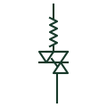

# Thyristor-controlled reactor

A shunt reactor in series with anti-parallel thyristors whose firing angle sets the reactive power absorbed.

[Canonical reference](https://eloragrid.ai/symbols/thyristor-controlled-reactor) · [Structured record](../entries/thyristor-controlled-reactor.json) · [All references](README.md)

Updated: 2026-10-28. Drawing use: SLD, Schematic. Reference families: IEC, IEEE / ANSI.

## What it represents

A thyristor-controlled reactor is an air-core reactor in series with a pair of anti-parallel thyristor valves. Delaying the firing angle reduces the current conduction period, so the reactor absorbs a continuously adjustable amount of reactive power from zero to its full rating.
Drawings show the reactor symbol with the thyristor pair below it, usually in a delta connection with the reactor split into two halves on either side of the valve. It is the inductive branch of a static var compensator and also appears in some arc furnace compensation schemes.
Partial conduction generates harmonic currents, mainly odd orders, so the TCR is almost always accompanied by filters. The symbol does not show the filter arrangement or the valve cooling, which is a significant part of the installation.

## How to read it

- The reactor is often drawn in two halves with the valve between them.
- Delta connection cancels triplen harmonics under balanced conditions.

## Drawing checklist

- State reactor rating and firing range.
- Show valve and connection.
- Reference associated filters.

## Important distinction

A TCR varies its absorption continuously; a thyristor-switched reactor is only fully on or fully off.

## Facts

- Control: Firing angle
- Output: Variable inductive Mvar
- Harmonics: Generated during partial conduction
- Preview: Independent educational illustration; consult the applicable standard and project legend for the exact graphic

## Public references

- [Static Var Compensators (SVC)](https://www.hitachienergy.com/products-and-solutions/facts/static-var-compensation-svc) — Hitachi Energy. Public SVC page naming the thyristor-controlled reactor branch.
- [AutoCAD Electrical: Reactors and inductors](https://help.autodesk.com/cloudhelp/2021/ENU/AutoCAD-Electrical/files/GUID-BAD50DBF-0951-44A0-BB4C-A57B4A4ED895.htm) — Autodesk. Public reactor symbol family context.

## Related references

- [Static var compensator](static-var-compensator.md)
- [Thyristor-switched capacitor](thyristor-switched-capacitor.md)
- [Reactor](reactor.md)
- [Silicon-controlled rectifier](silicon-controlled-rectifier.md)

Original educational concept geometry, CC BY 4.0. Unitless; not a certified standards glyph or manufacturer footprint.

Elora-authored explanations are CC BY 4.0. Linked standards and manufacturer material retain their own rights. Confirm project requirements using primary sources.
