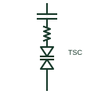

# Thyristor-switched capacitor

A capacitor bank switched in or out at current zero by anti-parallel thyristors, giving fast stepwise reactive support.

[Canonical reference](https://eloragrid.ai/symbols/thyristor-switched-capacitor) · [Structured record](../entries/thyristor-switched-capacitor.json) · [All references](README.md)

Updated: 2026-10-28. Drawing use: SLD, Schematic. Reference families: IEC, IEEE / ANSI.

## What it represents

A thyristor-switched capacitor connects a capacitor bank through anti-parallel thyristors, usually with a small series reactor to limit inrush. The thyristors switch the capacitor in at the instant when the network voltage equals the capacitor voltage, avoiding transients, and switch it out at current zero. It is either fully on or fully off.
Single-line diagrams show a capacitor, a series reactor and the thyristor pair stacked on a shunt branch. Several TSC branches may be drawn to give multiple steps of capacitive output in a static var compensator or a fast power factor correction system.
Because it switches in discrete steps, fine control comes from combining TSC branches with a TCR. The symbol does not show discharge resistors or the valve voltage rating, which must withstand twice the peak voltage when the capacitor is charged and the network reverses.

## How to read it

- A small series reactor is part of the branch, not a separate filter.
- Count branches to find available steps.

## Drawing checklist

- State capacitor Mvar per step.
- Show series reactor and valve.
- Reference switching logic.

## Important distinction

A TSC switches capacitors in steps without transients; a mechanically switched capacitor uses a breaker and is much slower.

## Facts

- Switching: At voltage match, out at current zero
- Output: Stepwise capacitive Mvar
- Series element: Inrush-limiting reactor
- Preview: Independent educational illustration; consult the applicable standard and project legend for the exact graphic

## Public references

- [Static Var Compensators (SVC)](https://www.hitachienergy.com/products-and-solutions/facts/static-var-compensation-svc) — Hitachi Energy. Public SVC page naming the thyristor-switched capacitor branch.
- [Capacitive component symbols](https://help.autodesk.com/cloudhelp/2021/ENU/AutoCAD-Electrical/files/GUID-74580D46-0731-41A6-918D-2DB419114207.htm) — Autodesk. Public capacitor symbol family context.

## Related references

- [Static var compensator](static-var-compensator.md)
- [Thyristor-controlled reactor](thyristor-controlled-reactor.md)
- [Three-phase power-factor capacitor](three-phase-power-factor-capacitor.md)
- [Detuned capacitor bank](detuned-capacitor-bank.md)

Original educational concept geometry, CC BY 4.0. Unitless; not a certified standards glyph or manufacturer footprint.

Elora-authored explanations are CC BY 4.0. Linked standards and manufacturer material retain their own rights. Confirm project requirements using primary sources.
