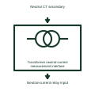

# Transformer neutral-current measurement interface

Identifies the separately measured transformer neutral-current signal serving the assigned protection input.

[Canonical reference](https://eloragrid.ai/symbols/transformer-neutral-current-measurement-interface) · [Structured record](../entries/transformer-neutral-current-measurement-interface.json) · [All references](README.md)

Updated: 2026-11-03. Drawing use: Schematic. Reference families: Manufacturer.

Representation: functional-block; installation focus: substations.
Neutral CT secondary
Neutral-current relay input

## What it represents

Identifies the separately measured transformer neutral-current signal serving the assigned protection input. Transformer monitoring interfaces connect physical sensors and protection calculations to the station's alarms and trip logic. Temperature, oil, gas, pressure and electrical measurements indicate different conditions and require separate interpretation.
In a substation transformer bay, a protection panel receives winding-current measurements and equipment alarm contacts. An operator can then distinguish an electrical protection operation from a cooling-system or physical-condition alarm. For this reference, the drawing identifies “Neutral CT secondary” at the input and “Neutral-current relay input” at the output. A measured neutral input differs from calculated residual current.
Identify the sensor or calculation, its monitored zone and its assigned response. Alarm and trip thresholds, sensor fitting and protection settings belong to the selected transformer documentation and the approved protection design. The functional block is an independent explanation of this named application. Equipment-specific ratings, terminal connections and operating conditions must be established in the project documentation.

## How to read it

- Start at the named input: Neutral CT secondary. Identify its source device or document and the state represented on the drawing.
- Follow the named output: Neutral-current relay input. Cross-reference its destination and separate the command from confirmation that the equipment responded.
- A measured neutral input differs from calculated residual current.
- Identify the sensor or calculation, its monitored zone and its assigned response. Alarm and trip thresholds, sensor fitting and protection settings belong to the selected transformer documentation and the approved protection design.

## Drawing checklist

- Label the source and connection reference for neutral ct secondary.
- Identify the destination and defined state of neutral-current relay input.
- Record the equipment or control-document revision supporting this functional block.
- Check this application limit in the project design: A measured neutral input differs from calculated residual current.

## Important distinction

A measured neutral input differs from calculated residual current. This reference describes the named application; it does not establish a new IEC graphical symbol, an ANSI device-function number or an exact manufacturer connection diagram.

## Facts

- Representation: Functional block
- Installation focus: Substations
- Input / boundary: Neutral CT secondary
- Output / connection: Neutral-current relay input
- Lookup label: TNMI is a library lookup label, not a standard device designation.

## Public references

- [SEL-487E transformer protection relay](https://selinc.com/products/487E/) — SEL. Public technical context for transformer protection and monitoring interfaces. Transformer protection, monitoring and measurement interfaces. The application text and educational graphic are independently authored; the publisher does not certify this representation.

## Related references

- [Power transformer](power-transformer.md)
- [Transformer differential protection](87t-transformer-differential-protection.md)
- [Transformer restricted-earth-fault zone interface](transformer-restricted-earth-fault-zone-interface.md)

Original educational concept geometry, CC BY 4.0. Unitless; not a certified standards glyph or manufacturer footprint.

Elora-authored explanations are CC BY 4.0. Linked standards and manufacturer material retain their own rights. Confirm project requirements using primary sources.
