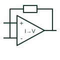

# Transimpedance amplifier

Converts an input current into an output voltage through the documented feedback arrangement.

[Canonical reference](https://eloragrid.ai/symbols/transimpedance-amplifier) · [Structured record](../entries/transimpedance-amplifier.json) · [All references](README.md)

Updated: 2026-10-27. Drawing use: Schematic. Reference families: Manufacturer.

## What it represents

Converts an input current into an output voltage through the documented feedback arrangement.
On a schematic, identify the detector/current input, feedback impedance and input reference and trace the voltage output and receiving acquisition circuit. Keep the component tag and signal/reference names consistent across the control drawing, terminal schedule and device documentation.
A transimpedance amplifier relates current to voltage; a transconductance amplifier relates voltage to current.
The preview is an independently drawn educational functional reference. Add the selected component’s actual power pins, terminal numbers, timing or analogue reference details when producing a construction drawing.

## How to read it

- Identify the detector/current input, feedback impedance and input reference.
- Trace the voltage output and receiving acquisition circuit.

## Drawing checklist

- Label the detector/current input, feedback impedance and input reference.
- Cross-reference the voltage output and receiving acquisition circuit.
- Add the selected device or circuit documentation revision, power/reference connections and project signal convention.

## Important distinction

A transimpedance amplifier relates current to voltage; a transconductance amplifier relates voltage to current.

## Facts

- Common schematic mnemonic: TIA — descriptive only; project/device documentation defines reference designations.
- Terminal / interface focus: The detector/current input, feedback impedance and input reference
- Artwork scope: Original educational functional/circuit reference; not a selected product pinout.

## Public references

- [ADA4530-1 — electrometer and current-to-voltage acquisition](https://www.analog.com/en/products/ada4530-1.html) — Analog Devices. Public primary manufacturer documentation establishes the component function or circuit/topology relationship. Preview geometry and drafting explanations are independently authored.

## Related references

- [Operational transconductance amplifier](operational-transconductance-amplifier.md)
- [PLC input / output](plc-io.md)

Original educational concept geometry, CC BY 4.0. Unitless; not a certified standards glyph or manufacturer footprint.

Elora-authored explanations are CC BY 4.0. Linked standards and manufacturer material retain their own rights. Confirm project requirements using primary sources.
