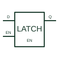

# Transparent D latch

Follows the input data while its latch-enable condition is active and retains it when that condition ends.

[Canonical reference](https://eloragrid.ai/symbols/transparent-d-latch) · [Structured record](../entries/transparent-d-latch.json) · [All references](README.md)

Updated: 2026-10-27. Drawing use: Schematic. Reference families: Manufacturer.

## What it represents

Follows the input data while its latch-enable condition is active and retains it when that condition ends.
On a schematic, identify the data input, latch-enable level and output-enable control and trace the retained data outputs and receiving circuit. Keep the component tag and signal/reference names consistent across the control drawing, terminal schedule and device documentation.
A transparent latch is level-sensitive; a D flip-flop captures data at a defined clock transition.
The preview is an independently drawn educational functional reference. Add the selected component’s actual power pins, terminal numbers, timing or analogue reference details when producing a construction drawing.

## How to read it

- Identify the data input, latch-enable level and output-enable control.
- Trace the retained data outputs and receiving circuit.

## Drawing checklist

- Label the data input, latch-enable level and output-enable control.
- Cross-reference the retained data outputs and receiving circuit.
- Add the selected device or circuit documentation revision, power/reference connections and project signal convention.

## Important distinction

A transparent latch is level-sensitive; a D flip-flop captures data at a defined clock transition.

## Facts

- Common schematic mnemonic: D-LATCH — descriptive only; project/device documentation defines reference designations.
- Terminal / interface focus: The data input, latch-enable level and output-enable control
- Artwork scope: Original educational functional/circuit reference; not a selected product pinout.

## Public references

- [SN74HC373 — transparent D latches](https://www.ti.com/lit/ds/symlink/sn74hc373.pdf) — Texas Instruments. Public primary manufacturer documentation establishes the component function or circuit/topology relationship. Preview geometry and drafting explanations are independently authored.

## Related references

- [Positive-edge D flip-flop](positive-edge-d-flip-flop.md)
- [PLC input / output](plc-io.md)

Original educational concept geometry, CC BY 4.0. Unitless; not a certified standards glyph or manufacturer footprint.

Elora-authored explanations are CC BY 4.0. Linked standards and manufacturer material retain their own rights. Confirm project requirements using primary sources.
