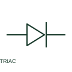

# TRIAC

A TRIAC is a bidirectional thyristor used for a documented AC switching or control function.

[Canonical reference](https://eloragrid.ai/symbols/triac) · [Structured record](../entries/triac.json) · [All references](README.md)

Updated: 2026-10-27. Drawing use: Schematic. Reference families: IEC, Manufacturer.

## What it represents

A TRIAC is a bidirectional thyristor used for a documented AC switching or control function. Its main terminals and gate connections must match the selected component.

## How to read it

- Identify the gate reference main terminal from the component data.
- The preview is an original explanation of this function. Match the actual drawing convention to its legend and the selected equipment documentation.

## Drawing checklist

- Label main terminals and gate
- Reference gate trigger circuit
- State AC load conditions

## Important distinction

A TRIAC is a controlled bidirectional device, unlike a DIAC trigger element.

## Facts

- Drawing role: Semiconductor function
- Representation scope: Functional concept; not an official standard graphic or a product footprint
- Public vendor block reference: HDI1\_S00659, VDI1\_S00659 (Autodesk identifiers; not IEC symbol numbers)
- Identifier status: The short label is a functional lookup label, not an assigned IEC or IEEE symbol number. Any separately listed Autodesk code is a verified vendor block name.

## Public references

- [AutoCAD Electrical: Semiconductor components](https://help.autodesk.com/cloudhelp/2021/ENU/AutoCAD-Electrical/files/GUID-AC954072-7314-4682-88AF-38160D61E9A2.htm) — Autodesk. Public documentation of this equipment function or named vendor variant; the illustration is independently authored and is not the source graphic.

## Related references

- [Resistor](resistor.md)
- [Power converter / inverter](power-converter.md)

Original educational concept geometry, CC BY 4.0. Unitless; not a certified standards glyph or manufacturer footprint.

Elora-authored explanations are CC BY 4.0. Linked standards and manufacturer material retain their own rights. Confirm project requirements using primary sources.
