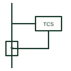

# Trip-circuit supervision relay

Relay that passes a small current through the trip circuit to check continuity and alarms if the circuit is broken.

[Canonical reference](https://eloragrid.ai/symbols/trip-circuit-supervision-relay) · [Structured record](../entries/trip-circuit-supervision-relay.json) · [All references](README.md)

Updated: 2026-10-28. Drawing use: Schematic. Reference families: IEC, Manufacturer.

## What it represents

A trip-circuit supervision relay monitors the wiring, auxiliary contacts and trip coil of a circuit breaker by passing a current too small to trip it. If the trip circuit is broken or its supply fails, the relay drops out and raises an alarm, so a failed trip path is found before a fault needs it.
Schemes differ in whether they supervise the circuit with the breaker open and closed, which needs resistors or connections across the breaker auxiliary contacts. The symbol shows the relay but the reader must check which states are actually covered.

## How to read it

- Check supervision covers both breaker positions.
- Verify the supervision current cannot operate the trip coil.

## Drawing checklist

- Show connections across trip contacts
- State supervised breaker states
- Reference alarm output

## Important distinction

Trip-circuit supervision monitors trip path continuity; a lockout relay latches after a trip.

## Facts

- Monitored items: Trip coil, wiring and supply
- Output: Alarm on loss of continuity
- Preview: Independent educational concept; consult the applicable standard and project legend for the exact graphic

## Public references

- [Relion 620: functions, codes and symbols](https://techdoc.relays.protection-control.abb/r/620-series-IEC-60870-5-103-Point-List-Manual/2.0-FP1-IEC/en-US/Functions-codes-and-symbols) — ABB. Public relay function list including trip-circuit supervision.
- [IEC graphical symbols for diagrams](https://tc3.iec.ch/tc-activity/graphical-symbols-for-diagrams/) — IEC. IEC context for graphical symbols used in diagrams; no IEC graphic is reproduced.

## Related references

- [Numerical protection relay (IED)](numerical-protection-relay.md)
- [Lockout](86-lockout.md)
- [Relay coil](relay-coil.md)

Original educational concept geometry, CC BY 4.0. Unitless; not a certified standards glyph or manufacturer footprint.

Elora-authored explanations are CC BY 4.0. Linked standards and manufacturer material retain their own rights. Confirm project requirements using primary sources.
