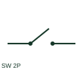

# Two-pole power switch

A two-pole power switch operates two circuit conductors through a common device.

[Canonical reference](https://eloragrid.ai/symbols/two-pole-power-switch) · [Structured record](../entries/two-pole-power-switch.json) · [All references](README.md)

Updated: 2026-10-27. Drawing use: SLD, Schematic. Reference families: IEC, Manufacturer.

## What it represents

A two-pole power switch operates two circuit conductors through a common device. The schematic may use separate pole elements linked by a mechanism annotation.

## How to read it

- Identify whether the two poles are phases, a phase and neutral, or DC conductors.
- The preview is an original explanation of this function. Match the actual drawing convention to its legend and the selected equipment documentation.

## Drawing checklist

- Name both conductors
- Show common operator
- Reference switching ratings

## Important distinction

Two poles do not necessarily mean a two-phase supply.

## Facts

- Drawing role: Switching path
- Representation scope: Functional concept; not an official standard graphic or a product footprint
- Public vendor block reference: HCB11Q50, VCB11Q50 (Autodesk identifiers; not IEC symbol numbers)
- Identifier status: The short label is a functional lookup label, not an assigned IEC or IEEE symbol number. Any separately listed Autodesk code is a verified vendor block name.

## Public references

- [AutoCAD Electrical: Power semiconductor switches](https://help.autodesk.com/cloudhelp/2021/ENU/AutoCAD-Electrical/files/GUID-54E4231E-F794-4527-9104-C2D7BA312077.htm) — Autodesk. Public documentation of this equipment function or named vendor variant; the illustration is independently authored and is not the source graphic.

## Related references

- [Disconnector](disconnector.md)
- [Circuit breaker](circuit-breaker.md)

Original educational concept geometry, CC BY 4.0. Unitless; not a certified standards glyph or manufacturer footprint.

Elora-authored explanations are CC BY 4.0. Linked standards and manufacturer material retain their own rights. Confirm project requirements using primary sources.
