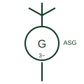

# Fixed-speed wind turbine generator (Type 1)

A wind turbine whose squirrel-cage induction generator connects to the network directly, running at nearly constant speed.

[Canonical reference](https://eloragrid.ai/symbols/type-1-fixed-speed-wind-turbine-generator) · [Structured record](../entries/type-1-fixed-speed-wind-turbine-generator.json) · [All references](README.md)

Updated: 2026-10-28. Drawing use: SLD. Reference families: IEC, IEEE / ANSI.

## What it represents

This symbol marks a Type 1 wind turbine: a rotor-driven squirrel-cage induction generator whose stator connects to the collector network through a soft starter and a step-up transformer, with no power converter in the main path. Speed varies only by the generator slip, typically one or two per cent, so the turbine is described as fixed-speed.
On a single-line diagram it is usually drawn as a blade or rotor glyph coupled to a generator circle marked for an induction machine, followed by the soft starter, switched capacitor steps for reactive power and the pad-mount or nacelle transformer. Older wind farms and small community turbines are the main places it still appears.
The symbol does not state the reactive demand of the generator, the capacitor step sizes or how the turbine behaves during voltage dips. Those values come from the turbine data sheet and the grid connection study, because an induction generator draws magnetising current from the network rather than supplying it.

## How to read it

- Look for shunt capacitor steps beside the generator; they supply the reactive power the induction machine absorbs.
- A soft starter or thyristor bypass shown in series is for connection inrush only, not for speed control.

## Drawing checklist

- State generator rating, voltage and slip range.
- Show soft starter and capacitor compensation steps.
- Reference the turbine step-up transformer and collector feeder.

## Important distinction

A Type 1 turbine has no converter in the power path; a Type 3 or Type 4 turbine shows a converter that sets speed and reactive output.

## Facts

- Generator type: Squirrel-cage induction
- Speed range: Near fixed, set by slip
- Reactive power: Absorbed; compensated by capacitors
- Preview: Independent educational illustration; consult the applicable standard and project legend for the exact graphic

## Public references

- [AutoCAD Electrical: Power station and substation concepts](https://help.autodesk.com/cloudhelp/2021/ENU/AutoCAD-Electrical/files/GUID-74EF80E8-018D-4A57-88BD-FF973F1B8185.htm) — Autodesk. Public wind generating station representation used as the site-level context for turbine symbols.
- [IEEE/ANSI 315-1975: graphic symbols for electrical and electronics diagrams](https://standards.ieee.org/ieee/315/515/) — IEEE Standards Association. Graphic-symbol standards context for rotating machines; no reproduced artwork.

## Related references

- [Wind generating station](wind-generating-station.md)
- [Three-phase induction generator](three-phase-induction-generator.md)
- [Variable-slip wind turbine generator (Type 2)](type-2-variable-slip-wind-turbine-generator.md)
- [Three-phase power-factor capacitor](three-phase-power-factor-capacitor.md)

Original educational concept geometry, CC BY 4.0. Unitless; not a certified standards glyph or manufacturer footprint.

Elora-authored explanations are CC BY 4.0. Linked standards and manufacturer material retain their own rights. Confirm project requirements using primary sources.
